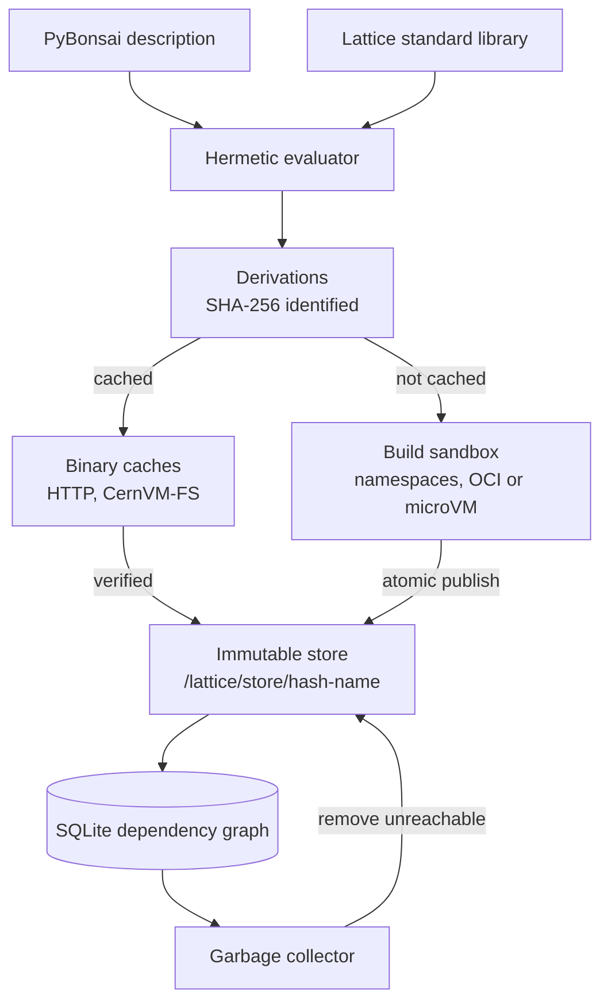

# PyrixOS

PyrixOS is a reproducible, declarative Linux distribution. The whole system, from one package to a complete machine, is described in PyBonsai, a restricted subset of Python, and built by the Lattice package manager. The same description always produces the same system, every build runs in isolation, and nothing is ever changed in place.

Declarative distributions such as NixOS and Guix System already offer these guarantees, but each asks the user to learn a dedicated language first. PyrixOS keeps Python syntax and removes the parts of Python that would let a result depend on anything other than its description.



## Components

| Component | Role |
| --- | --- |
| PyBonsai | The configuration language. Python 3.12 syntax interpreted from its syntax tree, never executed. Python builtins are not in scope and only allow-listed attributes can be read. No imports, I/O, `while` loops, mutation, recursion or dunder access, so evaluating a configuration file always finishes, never runs forever, and gives the same result on every machine. |
| Lattice | The package manager. Evaluates PyBonsai into derivations, drives builds, publishes results and collects garbage. Written in Python. Its default build sandbox needs no external container or build tools. |
| Derivations | Exact build recipes giving name, builder, arguments, environment and outputs, identified by the SHA-256 hash of their canonical form. |
| Build sandbox | Cloche. Fresh Linux user, mount, network, PID, UTS and IPC namespaces for every build, created directly with `unshare(2)`, with a seccomp filter and a fixed environment. No network, and only declared inputs visible, mounted read-only. An OCI container runtime or a lightweight virtual machine (Firecracker, Cloud Hypervisor, OpenVMM) can be used instead for stronger isolation. |
| Immutable store | Each build result lives at `/lattice/store/<hash>-<name>`. It is published with an atomic rename and made read-only. |
| Dependency database | An SQLite graph of store paths, run-time references and garbage collection roots. |
| Profiles and stacks | Profiles select what is active through atomic generations that can be rolled back. Several versions of a large stack, such as an NVIDIA HPC stack, can be installed together while a slot keeps exactly one active. |
| Binary caches | Prebuilt store paths are fetched from signed caches instead of being built, each with signed SLSA provenance. An HTTP cache serves every package, and a CernVM-FS repository serves large stacks as shallow paths that are fetched file by file on first use. |
| Garbage collector | Marks everything reachable from a root and removes the rest, without ever deleting a path that is still needed. |
| Trellis | The configuration system. Options are written in a subset of the Linux Kconfig language and chosen in a `menuconfig`-style console. A SAT solver checks that the choices fit together, explains a conflict and proposes fixes, and writes every value to a generated PyBonsai file. |

## Status

PyrixOS cannot build or install a complete system yet; the remaining work towards PyrixOS 1.0 is listed in the [development plan](development-plan.md). Its components are released on their own and can already be used in other projects: see [Using the components in other projects](#using-the-components-in-other-projects). The architecture is proposed in RFC 0001, which is open for comment, RFC 0002 proposes how the first tools of the distribution are built from a small binary seed, and RFC 0004 how a whole machine is described in PyBonsai and switched to. The code of Phase 1 is written: the PyBonsai evaluator, derivations and their hashes, the Lattice standard library, the `Lattice` library interface, the settings file, the daemon with its remote API, and `lattice eval`, which prints the derivations a file declares. The code of Phase 2 is written too: the namespace build sandbox, with its seccomp filter, fixed environment and time limits, together with `lattice sandbox-config` and `lattice backend-status`. The sandbox is published as its own package, Cloche, so that it can be used without Lattice. The code of Phase 3 is written as well: the immutable store, its SQLite dependency database, parallel builds that publish into the store, downloads with a known SHA-256 digest, `lattice build --check`, garbage collection roots and the garbage collector. The code of Phase 4 is written as well: profiles with generations and rollback, stacks assigned to slots, and activation that changes kernel modules only while their devices are unused and otherwise at the next boot. The code of Phase 5 is written as well: signed binary caches over HTTP and CernVM-FS with SLSA provenance, `lattice push`, substitution during builds, and shallow paths that `lattice materialise` turns into full copies. The code of Phase 6 is written as well: the OCI container and microVM backends, with Firecracker and Cloud Hypervisor tested, the guest kernel and init recorded in provenance, and `lattice check --backend` to compare the outputs of two backends. The code of the Trellis configuration system is written as well, specified in RFC 0003: the Kconfig subset, its encoding into clauses, a built-in SAT solver with optional PicoSAT, explanations of conflicts with fixes, the menu and line consoles, and `lattice config`. Work on the bootstrap of Phase 9 has started: the package set [`pkgs/00-bootstrap.pyb`](pkgs/00-bootstrap.pyb) builds stages 1 to 3 of RFC 0002 in the sandbox from a published seed, and the stage 3 compiler, C library and core tools refer to nothing of the seed or the earlier stages. The stage tools rebuild the seed from source, and seed 1, built that way, is a fixed point: the stages built from seed 1 give seed 1 again, byte for byte. The code of Phase 10 is written as well: `machine` and its records describe a whole machine, `lattice switch` builds it into one store path, activates `/etc`, users, mounts, slots and systemd units, and writes a systemd-boot entry for each generation, and builds get memory, CPU and process limits through a delegated cgroup. Work on Phase 11, specified in RFC 0005, has started: `pkgs/` is a package set of layer files evaluated in order, whose standard environment and base layer build the libraries and command line programs of the distribution, `lattice --package-set DIR` makes its names available to a description, and `closure` with `lattice export-registration` carries a closure and its store database onto a new machine. Later layers add Python, Meson, CMake and Rust built from source with mrustc, the Linux kernel, an initial RAM disk and systemd, and `disk_image` writes a reproducible disk image in the sandbox; the default system boots in QEMU through systemd-boot, the kernel and the initial RAM disk into systemd, reaches `multi-user.target` with every unit started, logs root in on the serial console and runs Lattice, which lists the booted generation. The installer image installs that system to a second disk, which boots on its own and logs root in with the password the installer set. The [development plan](development-plan.md) lists the phases.

## Development

The code lives in four Python packages. Each has its own repository and is included here as a git submodule under `src/`. The `src` directory only holds the checkouts and is not itself a Python package. Once installed, the packages are imported by their own names, so PyrixOS and third-party programs use the same API.

| Submodule path | Repository | Import name | Contents |
| --- | --- | --- | --- |
| `src/pybonsai` | [pybonsai](https://github.com/PacketFive/pybonsai) | `pybonsai` | The PyBonsai language: parser, checker and evaluator |
| `src/cloche` | [cloche](https://github.com/PacketFive/cloche) | `cloche` | The Cloche sandbox, which runs one program in unprivileged Linux namespaces |
| `src/lattice` | [lattice](https://github.com/PacketFive/lattice) | `lattice` | The Lattice package manager, which embeds PyBonsai and builds in Cloche |
| `src/trellis` | [trellis](https://github.com/PacketFive/trellis) | `trellis` | The Trellis configuration system, which resolves Kconfig options with a SAT solver |

PyBonsai, Cloche and Trellis know nothing of PyrixOS and can be used on their own: PyBonsai as a hermetic configuration language for any Python program, in the way Starlark is used outside Bazel, Cloche to run any untrusted program with only the inputs it is given, from Python or with the `cloche` command, and Trellis to configure any project with a Kconfig-style option tree.

All four need Python 3.12 or later. PyBonsai has no runtime dependencies, Cloche and Trellis depend only on [Pydantic](https://docs.pydantic.dev/), and Lattice depends on PyBonsai, Cloche and Pydantic, which defines its data models. `lattice config` needs Trellis, which the `config` extra of Lattice installs. Quality gates (formatting, lint, type checking and tests with coverage) are run with [pybootstrap](https://github.com/packetfive/pybootstrap), configured in each package's `pyproject.toml`.

```sh
git submodule update --init
python3 -m venv .venv
. .venv/bin/activate
python -m pip install --upgrade "pip>=25.1"
pip install --group src/pybonsai/pyproject.toml:dev --group src/cloche/pyproject.toml:dev \
  --group src/lattice/pyproject.toml:dev --group src/trellis/pyproject.toml:dev
pip install --config-settings editable_mode=strict -e src/pybonsai -e src/cloche -e src/trellis -e src/lattice
(cd src/pybonsai && pybootstrap check)
(cd src/cloche && pybootstrap check)
(cd src/lattice && pybootstrap check)
(cd src/trellis && pybootstrap check)
```

Each repository's `src` directory is the package itself, so the strict editable mode is needed for type checking to find it.

The bootstrap of RFC 0002 is built with Lattice from this repository. It needs Lattice 0.10.0 or later, for the `builtin:unpack` builder, and takes more than an hour on a machine with 12 cores. The settings file only names a store:

```sh
printf '[store]\nroot = "/var/tmp/pyrix-bootstrap"\n' > bootstrap.toml
lattice --settings bootstrap.toml build pkgs/00-bootstrap.pyb stage3
lattice --settings bootstrap.toml build pkgs/00-bootstrap.pyb seed_archive
```

`seed_archive` writes the seed that the stage tools build, with its SHA-256 digest, so that it can be compared with the published seed (RFC 0002 section 8). `bootstrap_tests` builds both and runs the bootstrap tests, which include that comparison.

The later layers of the package set (RFC 0005) are built through a file that names what it wants. It needs Lattice 0.12.0 or later, for `--package-set`. `base` holds the libraries and command line programs of `pkgs/20-base.pyb`:

```sh
echo 'target = base' > base.pyb
lattice --settings bootstrap.toml build --package-set pkgs base.pyb target
```

The default system of `pkgs/systems/default.pyb` builds into a raw disk image, `pyrixos.img`, with an EFI system partition and an ext4 root file system. `scripts/boot-test.sh` boots it in QEMU with the OVMF firmware, on a temporary overlay, and checks the serial console:

```sh
lattice --settings bootstrap.toml build --package-set pkgs pkgs/systems/default.pyb image
scripts/boot-test.sh /lattice/store/...-pyrixos-image-1/pyrixos.img
```

The installer image of `pkgs/systems/installer.pyb` boots to a root shell with the command `pyrixos-install DISK`, which installs the default system to `DISK` and sets the root password. Write the image to a USB stick, or test it in QEMU, where `scripts/install-test.sh` installs to a second disk and boots the result:

```sh
lattice --settings bootstrap.toml build --package-set pkgs pkgs/systems/installer.pyb image
scripts/install-test.sh /lattice/store/...-pyrixos-inst-image-1/pyrixos-inst.img
```

Every package has a coverage floor of 80%. Each repository runs the same gates in GitHub Actions on Python 3.12 and 3.13, and publishes a release to PyPI when a version tag is pushed; [RELEASING.md](RELEASING.md) describes the steps.

## Using the components in other projects

| PyPI package | Version | Import name | Use it for |
| --- | --- | --- | --- |
| [`pybonsai-lang`](https://pypi.org/project/pybonsai-lang/) | 1.2 | `pybonsai` | A hermetic configuration language for any Python program, with your own functions and types |
| [`cloche`](https://pypi.org/project/cloche/) | 1.1 | `cloche` | Running an untrusted program with only the inputs it is given, from Python or the `cloche` command |
| [`trellis-kconfig`](https://pypi.org/project/trellis-kconfig/) | 1.0 | `trellis` | Configuring any project with a Kconfig-style option tree checked by a SAT solver |
| [`pyrixos-lattice`](https://pypi.org/project/pyrixos-lattice/) | 0.12 | `lattice` | The package manager; below 1.0 until PyrixOS 1.0 |

```sh
pip install pybonsai-lang cloche
```

A project that depends on them should allow every release of the same major version, for example `pybonsai-lang>=1.0,<2` and `cloche>=1.0,<2`. The [integration guide](docs/integration.md) shows PyBonsai and Cloche used together: a file written in PyBonsai describes a job, and Cloche runs it.

## Using PyrixOS from Python

Everything the `lattice` command does is available to other programs, so PyrixOS can be built and managed from your own tools as well as from the command line. There are three ways in, and all three offer the same operations with the same results.

| Interface | Where it runs | Use it for |
| --- | --- | --- |
| `lattice.Lattice` | In your own Python process | Single-user machines, CI jobs and your own tools, with write access to the store |
| `lattice.Client` and `lattice daemon` | Your process talks to the daemon over the Unix socket `/run/lattice/daemon.sock` | Shared machines, where only the daemon writes to the store and users are identified by the kernel |
| Remote API | The daemon, over HTTPS with TLS 1.3 | Tools on other machines, in Python through `Client` or in any language through JSON-RPC 2.0 or REST |

```python
from lattice import Client, Lattice, LatticeAPI, LatticeError

def show(api: LatticeAPI, path: str) -> None:
    try:
        result = api.evaluate(path)
    except LatticeError as error:
        print(error)
    else:
        for name, drv in result.derivations.items():
            print(name, drv.store_path)

show(Lattice(), "hello.pyb")              # in this process
show(Client(), "hello.pyb")               # through the local daemon
show(Client("https://builder.example:7420", ca_file="ca.pem",
            cert_file="me.pem", key_file="me.key"), "hello.pyb")
```

| Rule | What it means for your program |
| --- | --- |
| Settings are explicit | `Lattice` reads nothing from the machine unless you call `Settings.load`. The daemon builds with its own settings, never the caller's. |
| No hidden state | A `Lattice` or `Client` object holds only its settings or connection details and an event handler, and several can be used side by side. |
| Results are data models | Methods return immutable [Pydantic](https://docs.pydantic.dev/) models such as `Evaluation` and `BuildResult`, never printed text. The same models are the JSON the daemon sends. |
| One error base class | Every error raised on purpose is a subclass of `LatticeError`, and `Client` raises the same class the daemon raised. |
| Progress is reported | The optional `on_event` callable receives one event per step, also from the daemon, and the same events go to the `lattice` logger. |
| Callers are checked | Over the socket the kernel identifies the caller. Remotely the caller presents a TLS client certificate or a bearer token. Users may evaluate, build and switch their own profiles, and admins may also collect garbage and push to caches. |
| Typed | Every package ships type hints (PEP 561). |
| Stable names | The names in `lattice.__all__`, `pybonsai.__all__`, `cloche.__all__` and `trellis.__all__`, and the `/v1/` paths of the daemon, are the public interface. From release 1.0 they follow semantic versioning, and a name is removed only after one minor release of `DeprecationWarning`. |

PyBonsai can also be used on its own, without Lattice, to evaluate configuration files with your own functions, Cloche to run programs in the sandbox, and Trellis to resolve Kconfig options. Their READMEs show how. RFC 0001 sections 6.1 and 6.2 define the library, the daemon and the remote API.

## Documentation

The documentation site is published at <https://www.packetfive.com/pyrixos/docs/> and is built from this repository with MkDocs Material.

```sh
python3 -m venv .venv
. .venv/bin/activate
pip install -r requirements-docs.txt
mkdocs serve
```

`mkdocs build --strict` writes the site to `site/`.

## Contributing

Design changes are proposed as RFCs, and comments on a draft RFC are made through issues on this repository.

AI-assisted contributions follow the [Linux Kernel AI Coding Assistants Policy](https://docs.kernel.org/process/coding-assistants.html). AI tools must not add `Signed-off-by:` or `Co-authored-by:` trailers. An AI-assisted commit carries an `Assisted-by: AGENT_NAME:MODEL_NAME` trailer giving the model family only, a `Reviewed-by:` trailer for the human reviewer and the submitter's own `Signed-off-by:`.

## License

GPL-2.0-only. See [LICENSE](LICENSE). Each component repository carries the same license.
