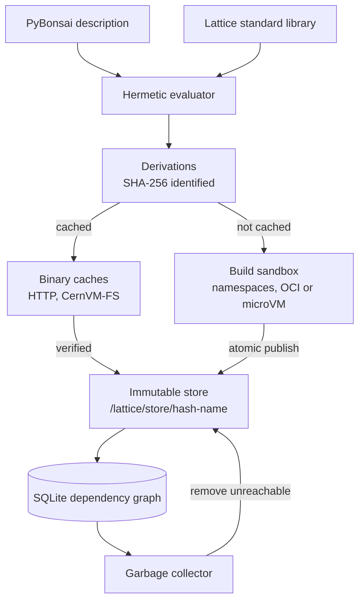

# PyrixOS

PyrixOS is a reproducible, declarative Linux distribution. The whole system, from one package to a complete machine, is described in PyBonsai, a restricted subset of Python, and built by the Lattice package manager. The same description always produces the same system, every build runs in isolation, and nothing is ever changed in place.

Declarative distributions such as NixOS and Guix System already offer these guarantees, but each asks the user to learn a dedicated language first. PyrixOS keeps Python syntax and removes the parts of Python that would let a result depend on anything other than its description.



## Components

| Component | Role |
| --- | --- |
| PyBonsai | The configuration language. Python 3.12 syntax interpreted from its syntax tree, never executed. Python builtins are not in scope and only allow-listed attributes can be read. No imports, I/O, `while` loops, mutation, recursion or dunder access, so evaluating a configuration file always finishes, never runs forever, and gives the same result on every machine. |
| Lattice | The package manager. Evaluates PyBonsai into derivations, drives builds, publishes results and collects garbage. Written in Python. Its default build sandbox needs no external container or build tools. |
| Derivations | Exact build recipes giving name, builder, arguments, environment and outputs, identified by the SHA-256 hash of their canonical form. |
| Build sandbox | Fresh Linux user, mount, network, PID, UTS and IPC namespaces for every build, created directly with `unshare(2)`, with a seccomp filter and a fixed environment. No network, and only declared inputs visible, mounted read-only. An OCI container runtime or a lightweight virtual machine (Firecracker, Cloud Hypervisor, OpenVMM) can be used instead for stronger isolation. |
| Immutable store | Each build result lives at `/lattice/store/<hash>-<name>`. It is published with an atomic rename and made read-only. |
| Dependency database | An SQLite graph of store paths, run-time references and garbage collection roots. |
| Profiles and stacks | Profiles select what is active through atomic generations that can be rolled back. Several versions of a large stack, such as an NVIDIA HPC stack, can be installed together while a slot keeps exactly one active. |
| Binary caches | Prebuilt store paths are fetched from signed caches instead of being built, each with signed SLSA provenance. An HTTP cache serves every package, and a CernVM-FS repository serves large stacks as shallow paths that are fetched file by file on first use. |
| Garbage collector | Marks everything reachable from a root and removes the rest, without ever deleting a path that is still needed. |

## Status

PyrixOS is at an early stage and cannot build or install a system yet. The architecture is proposed in RFC 0001, which is open for comment. The code of Phase 1 is written: the PyBonsai evaluator, derivations and their hashes, the Lattice standard library, the `Lattice` library interface, the settings file, the daemon with its remote API, and `lattice eval`, which prints the derivations a file declares. The code of Phase 2 is written too: the namespace build sandbox, with its seccomp filter, fixed environment and time limits, together with `lattice sandbox-config` and `lattice backend-status`. The [development plan](development-plan.md) lists the phases.

## Development

The code lives in two Python packages. Each has its own repository and is included here as a git submodule under `src/`. The `src` directory only holds the checkouts and is not itself a Python package. Once installed, the packages are imported by their own names, so PyrixOS and third-party programs use the same API.

| Submodule path | Repository | Import name | Contents |
| --- | --- | --- | --- |
| `src/pybonsai` | [pybonsai](https://github.com/PacketFive/pybonsai) | `pybonsai` | The PyBonsai language: parser, checker and evaluator |
| `src/lattice` | [lattice](https://github.com/PacketFive/lattice) | `lattice` | The Lattice package manager, which embeds PyBonsai |

Both need Python 3.12 or later. PyBonsai has no runtime dependencies, and Lattice depends only on PyBonsai and [Pydantic](https://docs.pydantic.dev/), which defines its data models. Quality gates (formatting, lint, type checking and tests with coverage) are run with [pybootstrap](https://github.com/packetfive/pybootstrap), configured in each package's `pyproject.toml`.

```sh
git submodule update --init
python3 -m venv .venv
. .venv/bin/activate
pip install --config-settings editable_mode=strict -e 'src/pybonsai[dev]' -e 'src/lattice[dev]'
(cd src/pybonsai && pybootstrap check)
(cd src/lattice && pybootstrap check)
```

Each repository's `src` directory is the package itself, so the strict editable mode is needed for type checking to find it.

Both packages have a coverage floor of 80%. Methods that belong to later phases, such as `build` and `gc`, already have their final signatures and raise `NotImplementedError` until their phase is complete.

## Using PyrixOS from Python

Everything the `lattice` command does is available to other programs, so PyrixOS can be built and managed from your own tools as well as from the command line. There are three ways in, and all three offer the same operations with the same results.

| Interface | Where it runs | Use it for |
| --- | --- | --- |
| `lattice.Lattice` | In your own Python process | Single-user machines, CI jobs and your own tools, with write access to the store |
| `lattice.Client` and `lattice daemon` | Your process talks to the daemon over the Unix socket `/run/lattice/daemon.sock` | Shared machines, where only the daemon writes to the store and users are identified by the kernel |
| Remote API | The daemon, over HTTPS with TLS 1.3 | Tools on other machines, in Python through `Client` or in any language through JSON-RPC 2.0 or REST |

```python
from lattice import Client, Lattice, LatticeAPI, LatticeError

def show(api: LatticeAPI, path: str) -> None:
    try:
        result = api.evaluate(path)
    except LatticeError as error:
        print(error)
    else:
        for name, drv in result.derivations.items():
            print(name, drv.store_path)

show(Lattice(), "hello.pyb")              # in this process
show(Client(), "hello.pyb")               # through the local daemon
show(Client("https://builder.example:7420", ca_file="ca.pem",
            cert_file="me.pem", key_file="me.key"), "hello.pyb")
```

| Rule | What it means for your program |
| --- | --- |
| Settings are explicit | `Lattice` reads nothing from the machine unless you call `Settings.load`. The daemon builds with its own settings, never the caller's. |
| No hidden state | A `Lattice` or `Client` object holds only its settings or connection details and an event handler, and several can be used side by side. |
| Results are data models | Methods return immutable [Pydantic](https://docs.pydantic.dev/) models such as `Evaluation` and `BuildResult`, never printed text. The same models are the JSON the daemon sends. |
| One error base class | Every error raised on purpose is a subclass of `LatticeError`, and `Client` raises the same class the daemon raised. |
| Progress is reported | The optional `on_event` callable receives one event per step, also from the daemon, and the same events go to the `lattice` logger. |
| Callers are checked | Over the socket the kernel identifies the caller. Remotely the caller presents a TLS client certificate or a bearer token. Users may evaluate, build and switch their own profiles, and admins may also collect garbage and push to caches. |
| Typed | Both packages ship type hints (PEP 561). |
| Stable names | The names in `lattice.__all__` and `pybonsai.__all__`, and the `/v1/` paths of the daemon, are the public interface. From release 1.0 they follow semantic versioning, and a name is removed only after one minor release of `DeprecationWarning`. |

PyBonsai can also be used on its own, without Lattice, to evaluate configuration files with your own functions. Its README shows how. RFC 0001 sections 6.1 and 6.2 define the library, the daemon and the remote API.

## Documentation

The documentation site is published at <https://www.packetfive.com/pyrixos/docs/> and is built from this repository with MkDocs Material.

```sh
python3 -m venv .venv
. .venv/bin/activate
pip install -r requirements-docs.txt
mkdocs serve
```

`mkdocs build --strict` writes the site to `site/`.

## Contributing

Design changes are proposed as RFCs, and comments on a draft RFC are made through issues on this repository.

AI-assisted contributions follow the [Linux Kernel AI Coding Assistants Policy](https://docs.kernel.org/process/coding-assistants.html). AI tools must not add `Signed-off-by:` or `Co-authored-by:` trailers. An AI-assisted commit carries an `Assisted-by: AGENT_NAME:MODEL_NAME` trailer giving the model family only, a `Reviewed-by:` trailer for the human reviewer and the submitter's own `Signed-off-by:`.
