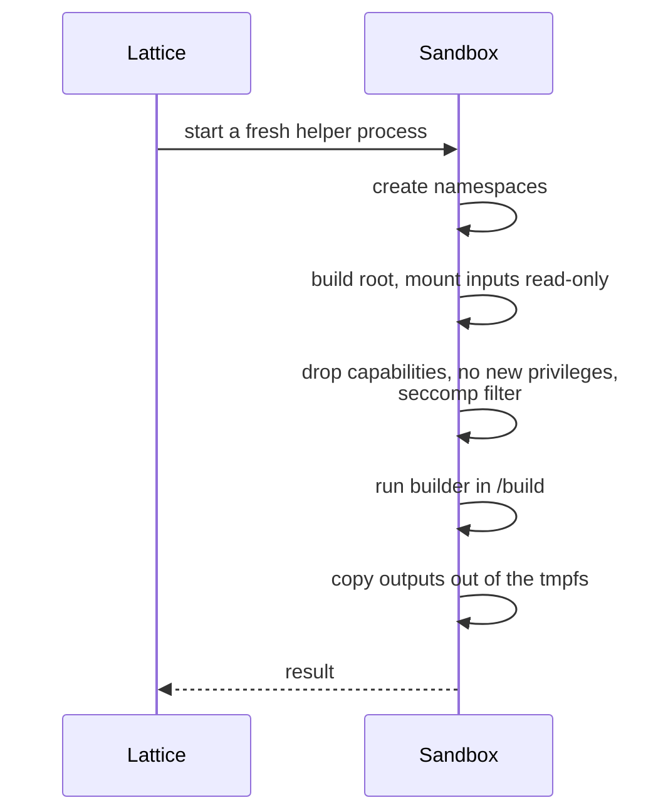

# Build sandbox

<div class="pyrix-meta" markdown>
<span class="pyrix-flag">Draft</span>
<span>Defined in <strong>RFC 0001 §9</strong></span>
<span>Default backend <strong>unshare(2)</strong></span>
</div>

A reproducible description is only half of a reproducible build. The build itself must not be able to reach anything the description does not mention, such as a library that happens to be installed on the host, a file in a home directory, or a server on the network. Lattice prevents this by running every build in a fresh set of Linux namespaces that it creates itself through the `unshare(2)` system call. This default needs no Docker, Podman or Bubblewrap. A machine can instead use an OCI container runtime or a lightweight virtual machine, described under [Backends](#backends).

## Isolation

| Namespace | What the build sees |
| --- | --- |
| User | It runs as root inside the sandbox, but only as the unprivileged Lattice user on the host. |
| Mount | Its own filesystem tree, which the host never sees and which disappears when the build ends. |
| Network | A loopback interface and nothing else. There is no route to any other machine. |
| PID | Its own process tree, in which the builder is PID 1. Host processes are invisible. |
| UTS | A fixed hostname, `localhost`, so the host's name cannot end up in a build. |
| IPC | No shared memory, semaphores or message queues with host processes. |

## Filesystem

The root of the sandbox is an empty `tmpfs`. Lattice gives it a writable `/build` for the build to work in and a writable `/lattice/store`, in which the build creates each output at its final store path. The `$out` variable holds that path, so an installation prefix the build records is already correct. The store paths of the build's declared inputs are mounted read-only at their usual locations, a fresh `/proc` is mounted for the sandbox's own processes, and `/dev` holds only `null`, `zero`, `full`, `random`, `urandom` and a `/dev/shm`. An input that is itself a symbolic link is recreated as a link, never mounted, so it cannot expose the host path it names. Nothing else from the host is present, so the builder itself must be a program inside one of the inputs.

## One build, start to finish



When the builder exits, the kernel ends every process it started, because they all belong to the sandbox's PID namespace. Lattice then copies each output the derivation declared out of the sandbox. The copy never follows a symbolic link the build made, so a link cannot point it at a host file. If an output is missing, holds a FIFO, socket or device file, or the builder failed, nothing is published.

## Hardening

The builder holds no capabilities, so although it is root inside the sandbox it cannot unmount or change its read-only inputs. It cannot gain privileges either, because Lattice sets the kernel's "no new privileges" flag before starting it. A seccomp filter then refuses the few system calls that would leave something dangerous in the store or reach kernel state the namespaces do not isolate: setting the setuid or setgid bit, setting extended attributes, using kernel keyrings, and io_uring, which would bypass the filter. A refused call returns an error rather than ending the build. Setuid and setgid bits that a file was created with are dropped when the outputs are copied out. Core dumps are off, open files are capped, the umask is `022`, and a build that runs too long or stays silent too long is stopped.

## Build environment

A build sees only the environment variables its derivation declares, one variable per output, such as `$out`, holding the output's store path, and a fixed set that it cannot change.

| Variable | Value | Why |
| --- | --- | --- |
| `SOURCE_DATE_EPOCH` | `315532800` | Tools that embed a date use 1980-01-01 instead of the clock. |
| `TZ`, `LANG` | `UTC`, `C.UTF-8` | Output does not depend on the host's time zone or language. |
| `HOME` | `/homeless` | It does not exist, so no user configuration is read. |
| `TMPDIR` | `/build` | Temporary files stay in the sandbox. |
| `PATH` | `/path-not-set` | Programs come only from store paths the derivation names. |

Every setting of the sandbox maps to a field of the standard OCI runtime configuration, and `lattice sandbox-config` prints that configuration for any derivation, so the sandbox can be reviewed with existing container security tools.

```console
$ lattice sandbox-config hello.pyb hello
$ lattice backend-status
namespaces: available
oci: not available in this release
microvm: not available in this release
```

## Backends

| Backend | Runs the build in | Isolation boundary |
| --- | --- | --- |
| Namespaces (default) | Linux namespaces created by Lattice, with nothing else installed | The host kernel |
| OCI container | A rootless runtime such as `crun`, `runc` or `youki`, with no daemon and no image | The host kernel |
| MicroVM | A lightweight virtual machine under Firecracker, Cloud Hypervisor or OpenVMM, or the Hyper-V utility VM on Windows | The hypervisor, with the build on its own guest kernel |

With the microVM backend the build no longer depends on the host kernel. The guest kernel is itself a store path, so it is fixed by its hash and recorded in the build's provenance. Every backend gives the build the same filesystem, hardening and environment, and none gives it a network. If the chosen backend is unavailable, Lattice refuses to build rather than falling back to a weaker one.

## Host requirements

The sandbox needs unprivileged user namespaces, which most current Linux kernels provide. Some distributions restrict them by default, for example Ubuntu through the `kernel.apparmor_restrict_unprivileged_userns` setting. In that case Lattice reports the problem and refuses to build, rather than falling back to a build without isolation. `lattice backend-status` names the setting that blocks the sandbox. The OCI backend needs its runtime program installed, and the microVM backend needs a hypervisor such as KVM.

## Implementation

The namespace backend is the `lattice.sandbox` package. It is written in Python and calls the few system calls the standard library lacks, such as `mount` and `pivot_root`, through `ctypes`.

| Module | Contents |
| --- | --- |
| `spec.py` | The sandbox description every backend consumes, and its OCI form |
| `environment.py` | The builder's environment and the rules it must follow |
| `seccomp.py` | The denied system calls, as a BPF program and as OCI rules |
| `libc.py` | `mount`, `pivot_root`, `prctl` and capability calls through `ctypes` |
| `namespaces.py` | The namespace backend and the helper process that sets up each build |
| `runner.py` | Runs one build, records its log and enforces the time limits |
| `probe.py` | Tests which backends can run on the machine |

The full specification, including the order of system calls, why the builder needs a second `fork`, and the provenance and compliance targets, is in [RFC 0001 §9](../rfc/0001-pyrixos-architecture.md#9-build-sandbox).
