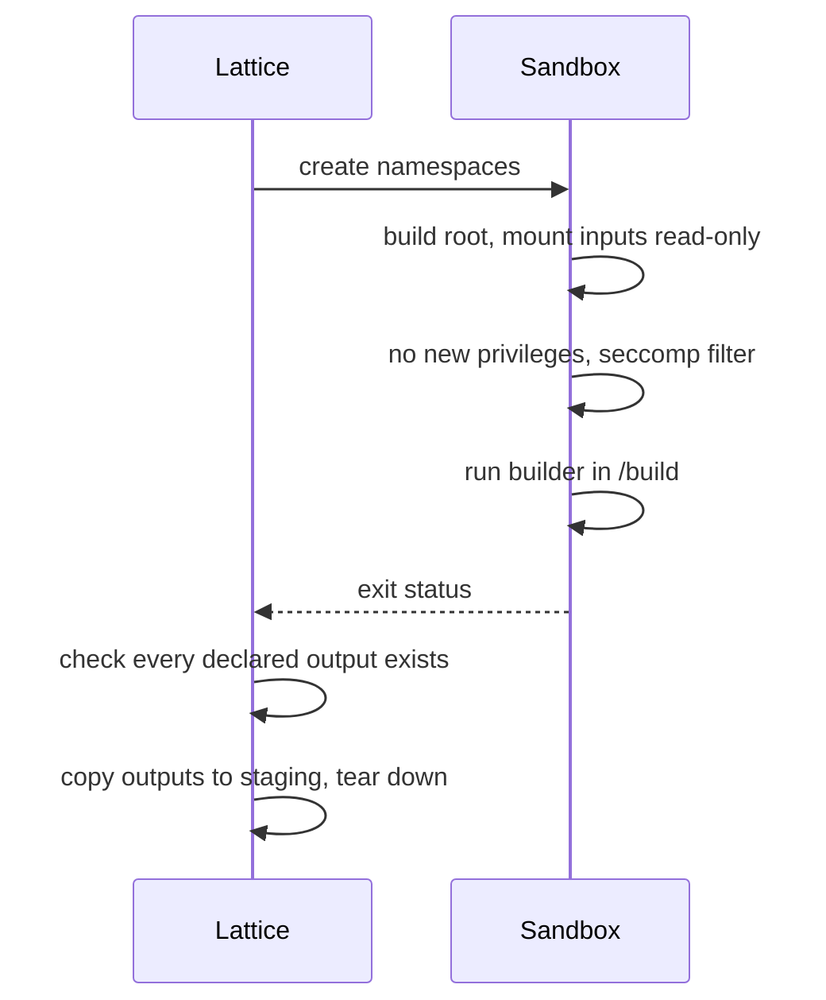

# Build sandbox

Draft
Defined in <strong>RFC 0001 §9</strong>
Default backend <strong>unshare(2)</strong>

A reproducible description is only half of a reproducible build. The build itself must not be able to reach anything the description does not mention, such as a library that happens to be installed on the host, a file in a home directory, or a server on the network. Lattice prevents this by running every build in a fresh set of Linux namespaces that it creates itself through the `unshare(2)` system call. This default needs no Docker, Podman or Bubblewrap. A machine can instead use an OCI container runtime or a lightweight virtual machine, described under [Backends](#backends).

## Isolation

| Namespace | What the build sees |
| --- | --- |
| User | It runs as root inside the sandbox, but only as the unprivileged Lattice user on the host. |
| Mount | Its own filesystem tree, which the host never sees and which disappears when the build ends. |
| Network | A loopback interface and nothing else. There is no route to any other machine. |
| PID | Its own process tree, in which the builder is PID 1. Host processes are invisible. |
| UTS | A fixed hostname, `localhost`, so the host's name cannot end up in a build. |
| IPC | No shared memory, semaphores or message queues with host processes. |

## Filesystem

The root of the sandbox is an empty `tmpfs`. Lattice creates two writable directories in it, `/build` for the build to work in and `/out` for what it produces. The store paths of the build's declared inputs are mounted read-only at their usual locations, and a fresh `/proc` is mounted for the sandbox's own processes. Nothing else from the host is present, so a write anywhere outside `/build`, `/out` and the temporary root fails.

## One build, start to finish

When the builder exits, the kernel ends every process it started, because they all belong to the sandbox's PID namespace. Lattice checks that each output the derivation declared is present in `/out`. If one is missing or the builder failed, nothing is published.

## Hardening

The builder cannot gain privileges, because Lattice sets the kernel's "no new privileges" flag before starting it. A seccomp filter then refuses the few system calls that would leave something dangerous in the store or reach kernel state the namespaces do not isolate: setting the setuid or setgid bit, setting extended attributes, and using kernel keyrings. A refused call returns an error rather than ending the build. Core dumps are off, open files are capped, and a build that runs too long or stays silent too long is stopped.

## Build environment

A build sees only the environment variables its derivation declares, plus a fixed set that it cannot change.

| Variable | Value | Why |
| --- | --- | --- |
| `SOURCE_DATE_EPOCH` | `315532800` | Tools that embed a date use 1980-01-01 instead of the clock. |
| `TZ`, `LANG` | `UTC`, `C.UTF-8` | Output does not depend on the host's time zone or language. |
| `HOME` | `/homeless` | It does not exist, so no user configuration is read. |
| `TMPDIR` | `/build` | Temporary files stay in the sandbox. |
| `PATH` | `/path-not-set` | Programs come only from store paths the derivation names. |

Every setting of the sandbox maps to a field of the standard OCI runtime configuration, and `lattice sandbox-config` prints that configuration for any derivation, so the sandbox can be reviewed with existing container security tools.

## Backends

| Backend | Runs the build in | Isolation boundary |
| --- | --- | --- |
| Namespaces (default) | Linux namespaces created by Lattice, with nothing else installed | The host kernel |
| OCI container | A rootless runtime such as `crun`, `runc` or `youki`, with no daemon and no image | The host kernel |
| MicroVM | A lightweight virtual machine under Firecracker, Cloud Hypervisor or OpenVMM, or the Hyper-V utility VM on Windows | The hypervisor, with the build on its own guest kernel |

With the microVM backend the build no longer depends on the host kernel. The guest kernel is itself a store path, so it is fixed by its hash and recorded in the build's provenance. Every backend gives the build the same filesystem, hardening and environment, and none gives it a network. If the chosen backend is unavailable, Lattice refuses to build rather than falling back to a weaker one.

## Host requirements

The sandbox needs unprivileged user namespaces, which most current Linux kernels provide. Some distributions restrict them by default, for example Ubuntu through the `kernel.apparmor_restrict_unprivileged_userns` setting. In that case Lattice reports the problem and refuses to build, rather than falling back to a build without isolation. The OCI backend needs its runtime program installed, and the microVM backend needs a hypervisor such as KVM.

The full specification, including the order of system calls, why the builder needs a second `fork`, and the provenance and compliance targets, is in [RFC 0001 §9](../rfc/0001-pyrixos-architecture.md#9-build-sandbox).
