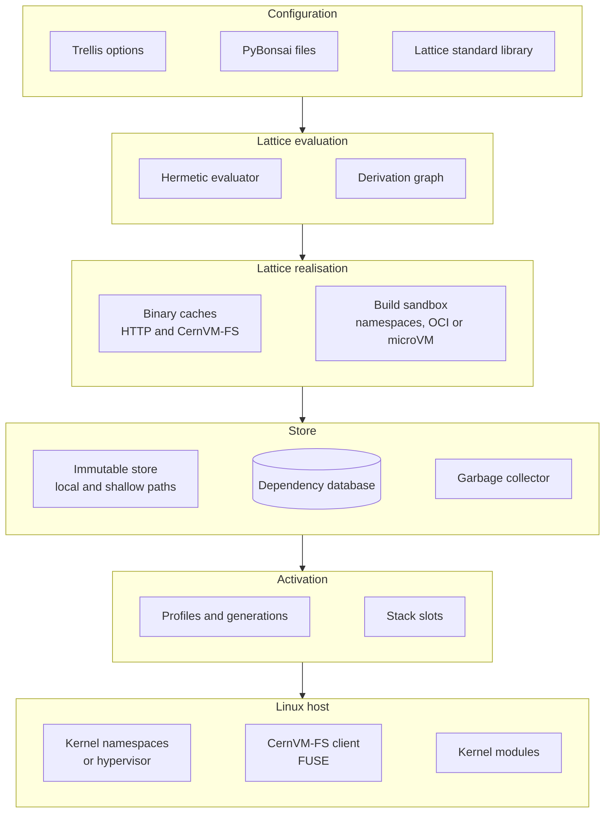
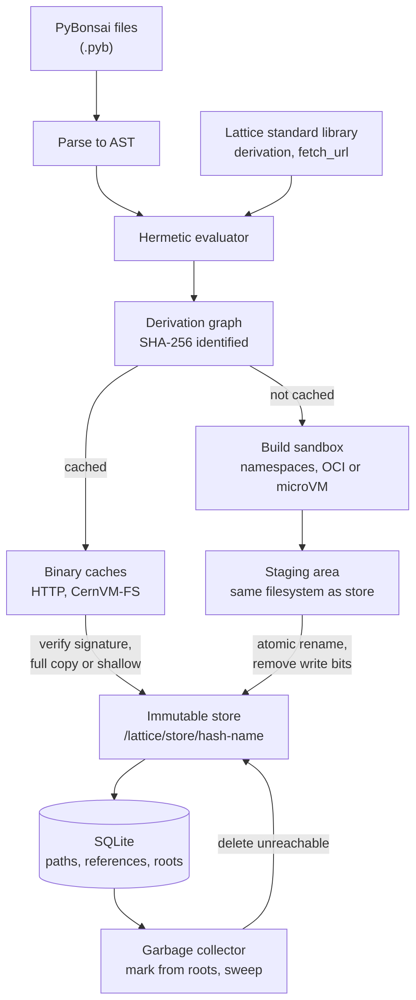
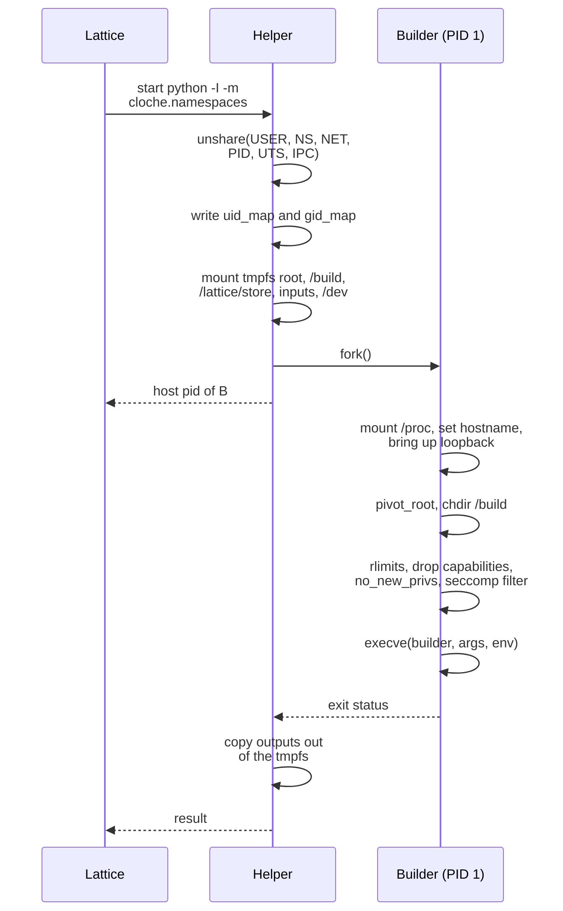

# RFC 0001 · PyrixOS Architecture

<div class="pyrix-meta" markdown>
<span class="pyrix-flag">Draft</span>
<span>RFC <strong>0001</strong></span>
<span>Created <strong>2026-10-07</strong></span>
<span>Scope <strong>Whole system</strong></span>
</div>

| Field | Value |
| --- | --- |
| Status | Draft, open for comment |
| Supersedes | None |
| Components | PyBonsai, Lattice evaluator, derivations, build sandbox, store, dependency database, garbage collector, profiles and stacks, binary caches |

The key words MUST, MUST NOT, SHOULD, SHOULD NOT and MAY in this document are to be interpreted as described in [RFC 2119](https://www.rfc-editor.org/rfc/rfc2119) and [RFC 8174](https://www.rfc-editor.org/rfc/rfc8174) when, and only when, they appear in all capitals.

## 1. Summary

PyrixOS is a Linux distribution in which the entire system, from a single package to the full machine configuration, is described declaratively and built reproducibly. Descriptions are written in PyBonsai, a restricted subset of Python. While Lattice evaluates a PyBonsai file, the file cannot read or write files, open network connections, read the clock or environment variables, or change a value after creating it. The result therefore depends only on the file and the inputs it declares, and is the same on every machine. PyBonsai also has no `while` loops and no recursion, so evaluating a file always finishes and can never run forever. The Lattice package manager evaluates those descriptions into derivations, builds each derivation in an isolated sandbox with no network access, by default a set of Linux namespaces and optionally a container or a lightweight virtual machine, and places the result in an immutable store. An SQLite database records which store paths depend on which, and a garbage collector removes anything that is no longer reachable. Profiles decide what is active, and stacks let several versions of a large software stack be installed together with exactly one in use.

This RFC defines the architecture and the contract between those components. Implementation work follows acceptance of this RFC.

## 2. Components

PyrixOS is built in layers. The diagram reads from top to bottom, from the configuration a user writes to the Linux host that everything runs on. Each layer uses only what the layers below it provide.



| Layer | Component | Role | Defined in |
| --- | --- | --- | --- |
| Configuration | PyBonsai | The configuration language, a restricted subset of Python 3.12 syntax. | Section 7 |
| Configuration | Trellis | Resolves the user's choices of system options against a tree of options in a Kconfig subset with a SAT solver, explains conflicts, and writes every value to a generated PyBonsai file. A separate package. | RFC 0003 |
| Configuration | Lattice standard library | The only functions a PyBonsai file can call, such as `derivation`, `fetch_url`, `stack` and `profile`. | Section 7.6 |
| Lattice evaluation | Hermetic evaluator | Parses a PyBonsai file and interprets its syntax tree against an allow list. It never runs the file as Python. | Section 7 |
| Lattice evaluation | Derivation graph | The evaluator's output. Each derivation is an exact description of one build, named by a SHA-256 hash of its inputs. | Section 8 |
| Lattice realisation | Binary caches | Signed caches from which Lattice fetches a path that a trusted machine has already built. An HTTP cache serves every package, and a CernVM-FS repository serves large stacks. | Section 14 |
| Lattice realisation | Build sandbox | Runs each build that no cache provides with no network access and only its inputs visible. The default backend uses Linux namespaces, and optional backends use an OCI container runtime or a lightweight virtual machine. | Section 9 |
| Store | Immutable store | Read-only paths under `/lattice/store`, either local directories or shallow paths that link into CernVM-FS. | Sections 10 and 14.5 |
| Store | Dependency database | An SQLite database of store paths, the references between them and the garbage collector roots. | Section 11 |
| Store | Garbage collector | Deletes every path that no root can reach. | Section 12 |
| Activation | Profiles and generations | Decide what is active. Each change creates a new generation, and rolling back is a switch to an earlier one. | Section 13.1 |
| Activation | Stack slots | Keep exactly one version of a large stack, such as an NVIDIA HPC stack, active at a time. | Section 13.2 |
| Linux host | Kernel namespaces or a hypervisor, FUSE and kernel modules | The kernel features and hypervisor Lattice uses to isolate builds, mount CernVM-FS repositories and load stack drivers. | Sections 9, 13.3 and 14.7 |

## 3. Motivation

Declarative package managers such as Nix and Guix have shown that a whole operating system can be built as a pure function of its description. The same inputs give the same system, upgrades are atomic, and a previous generation can always be restored. Adoption is limited by the configuration language. Nix uses its own lazy functional language, and Guix uses Scheme. Administrators who already know Python have to learn a new language and its idioms before they can change one package.

Standard Python is imperative and allows side effects, which breaks reproducible builds. PyrixOS therefore implements PyBonsai as a restricted Python language evaluated by a hermetic AST evaluator. A PyBonsai file is parsed with `ast.parse` and its syntax tree is walked and interpreted, never executed with `eval` or `exec`. The evaluator accepts only an allow-listed set of constructs, bans unbounded loops, imports and dunder access, and makes every value immutable.

## 4. Goals and non-goals

| Goals | Non-goals |
| --- | --- |
| Configuration written in a familiar Python syntax | Running arbitrary Python or third-party Python modules during evaluation |
| Evaluation of a configuration file that always finishes and gives the same result on every machine | General-purpose programming in the configuration language |
| Builds isolated from the network and from the host filesystem | Container image distribution, or a container runtime or hypervisor written for PyrixOS |
| An immutable store where every path is named by a hash of its inputs | Binary-compatible reuse of the Nix store or Nix expressions |
| Garbage collection that never removes a path reachable from a root | A cache server written for PyrixOS; caches are static files or CernVM-FS |
| Several versions of a software stack installed together, with exactly one active per slot | Several active versions of one stack on the same machine |
| Built-in timing for evaluation, sandbox and garbage collection | Performance targets; this RFC defines what is measured, not the thresholds |
| Prebuilt store paths fetched from signed caches, in full or on demand | Building derivations on remote machines |
| A built-in namespace sandbox in pure Python, with optional container and microVM backends for stronger isolation | |
| Signed build provenance meeting SLSA Build level 3 | |
| Every operation available through a typed Python library, a local daemon and a remote API, with the same results from each | |

## 5. Terminology

PyBonsai
:   The configuration language. A subset of Python syntax with the semantics defined in section 7.

Evaluator
:   The part of Lattice that parses a PyBonsai file and interprets its syntax tree.

Derivation
:   A complete, immutable description of one build: its name, builder, arguments, environment and named outputs. Defined in section 8.

Realisation
:   Running a derivation's build and registering its outputs in the store.

Store path
:   A directory under `/lattice/store` named `<hash>-<name>`, where `<hash>` is the derivation hash. Store paths never change after registration.

Reference
:   A directed edge from one store path to another store path that it needs at run time.

GC root
:   A store path that MUST be kept, such as the current system generation or a path a user has pinned.

Profile and generation
:   A profile is a named sequence of generations, and each generation is one environment in the store. One generation of each profile is current. Defined in section 13.1.

Stack and slot
:   A stack is a set of packages combined into one derivation. A slot is a named place where exactly one stack is active. Defined in section 13.2.

Substitution and binary cache
:   Substitution is fetching a store path that someone else has built instead of building it. A binary cache is a signed collection of store paths that machines substitute from. Defined in section 14.

Shallow path
:   A store path registered as a symlink into a mounted CernVM-FS repository. Its files are fetched when first opened. Defined in section 14.5.

Sandbox backend
:   The mechanism that isolates a build. The default backend uses Linux namespaces; optional backends use an OCI container runtime or a lightweight virtual machine (section 9.7).

Daemon
:   The `lattice daemon` service. It owns the store and runs operations for other processes over a Unix socket and, optionally, a remote API over TLS (section 6.2).

Provenance
:   A signed record of how a store path was built: from which derivation, with which inputs, on which machine and backend (section 14.9).

## 6. Architecture overview



Each stage only consumes the output of the stage before it. The evaluator never builds anything, the sandbox never evaluates PyBonsai, and the store never runs build code. That separation lets each stage be tested, measured and reasoned about on its own.

### 6.1 Programmatic interface

PyBonsai and Lattice are Python libraries first. Every operation of the `lattice` command MUST be available as a method of the `lattice.Lattice` class, and the command MUST only parse its arguments, call that method and print the result. A program that embeds Lattice, such as a provisioning tool or a test harness, therefore gets the same behaviour as the command without running it as a subprocess.

| Method | Operation | Section |
| --- | --- | --- |
| `evaluate(path)`, `evaluate_source(text)` | Evaluate PyBonsai and return the names it defines, including its derivations | 7 |
| `build(drv)` | Realise a derivation and its inputs, substituting from caches where possible | 9, 10, 14 |
| `check(drv)` | Rebuild a registered derivation and compare the outputs | 16 |
| `plan(drv)` | List what a build would reuse, download or build | 10 |
| `path_info(path)`, `verify(path)` | Report what the database records about a path, and hash its contents again | 11 |
| `gc()` | Collect unreachable store paths | 12 |
| `add_root(name, path)`, `remove_root(name)`, `roots()` | Change and list the named roots that collection keeps | 12 |
| `switch(profile, drv)` | Build a derivation and make it the new current generation of a profile | 13 |
| `rollback(profile, generation)`, `generations(profile)`, `delete_generations(profile, keep)` | Make an existing generation current, list the generations, and delete old ones | 13.1 |
| `slots()` | Report the active stack of each slot and the stack the current system generation wants | 13.2 |
| `activate_boot()` | Load the kernel modules and create the slots of the current system generation at boot | 13.3 |
| `push(paths, cache)` | Sign and upload store paths with their provenance | 14 |

The library follows these rules.

1. Settings are passed in as a `Settings` object. The library MUST NOT read settings from the machine unless the program asks it to. Evaluation limits are not settings (section 7.7).
2. A `Lattice` object holds only its settings and event handler, and several objects MAY be used in one process.
3. Methods return immutable Pydantic data models, not text.
4. Every error raised on purpose is a subclass of `LatticeError`. Errors from PyBonsai are wrapped, and the original is kept as the cause.
5. Progress is reported as immutable event objects passed to an optional `on_event` callable, and the same events are logged to the `lattice` logger.
6. Both packages ship type hints as described in PEP 561.
7. The names in each package's `__all__` are its public interface. From release 1.0 they follow semantic versioning, and a name is removed only after one minor release in which using it raises a `DeprecationWarning`.

The same operations are available to other processes through the daemon of section 6.2.

### 6.2 Daemon and remote API

`lattice daemon` lets processes that cannot write to the store use it. It runs as a dedicated `lattice` user, is the only process that writes to `/lattice/store` and its database, and performs each operation by calling the `Lattice` class of section 6.1 with its own settings. A caller's settings never reach a build. The `lattice.Client` class has the same methods, results and errors as `Lattice`, and both satisfy the `LatticeAPI` protocol (PEP 544), so a program moves between them by changing one line.

| Transport | Address | How the caller is identified |
| --- | --- | --- |
| Unix socket | `/run/lattice/daemon.sock` | The kernel reports the caller's user and groups through `SO_PEERCRED`. Root, the daemon's own user and members of `lattice-admins` are admins, members of `lattice-users` are users, and anyone else is refused. |
| Remote API | `host:port` in the daemon settings | TLS 1.3 only. The caller presents a client certificate signed by the configured client CA and listed by its common name, or a bearer token whose SHA-256 digest is listed. A certificate takes precedence. Plain HTTP is not offered. |

Both transports serve one HTTP interface in two styles. Parameters and results are the same Pydantic data models in both, and in the library.

| Request | Style | Meaning |
| --- | --- | --- |
| `POST /v1/rpc` | JSON-RPC 2.0 | A request, notification or batch. Method names are the `Lattice` method names. Parameters are passed by name. |
| `POST /v1/<method>` | REST | The JSON body holds the parameters of `<method>`, and the response body is its result. |
| `GET /v1/info` | REST | The daemon version, the API version and the method names. |

A JSON-RPC client that sends `Accept: application/x-ndjson` receives progress events as JSON-RPC `event` notifications, one JSON object per line, before the response. Errors are JSON-RPC error objects in both styles, and REST also sets the HTTP status. The `data.type` member of an error names the `LatticeError` subclass, so a client raises the same class the daemon raised. An error that is not a `LatticeError` is reported only as an internal error, because its message may describe the daemon's machine, and the daemon logs it.

| Method | Role | Further rule |
| --- | --- | --- |
| `evaluate_source` | user | |
| `build`, `check`, `plan` | user | |
| `path_info`, `verify`, `roots` | user | |
| `add_root`, `remove_root` | user | A user may only add or remove roots named `per-user/<name>` and below it. An admin may change any root. |
| `generations`, `slots` | user | |
| `switch`, `rollback`, `delete_generations` | user | A user may only change `per-user/<name>` and the profiles below it, where `<name>` is the user's own name. An admin may change any profile. |
| `gc`, `push` | admin | |

`activate_boot` is not offered by the daemon, because it runs at boot before the daemon starts.

The daemon MUST NOT open a file named by a caller. `Client.evaluate` reads the file in the caller's process and sends its text, so a caller cannot make the daemon read a file the caller could not read. A derivation sent to the daemon is rebuilt from its fields, and a hash or store path sent with it MUST match the values computed from those fields. Requests larger than a configured limit, 16 MiB by default, are refused, and the evaluation limits of section 7.7 apply to every request.

The interface is versioned by its path prefix. An incompatible change gets a new prefix, and the old prefix is kept for at least one minor release. The daemon settings (socket, groups, TLS files, client certificates and token digests) are part of the Lattice settings of section 6.3.

### 6.3 Settings file

A machine's settings are a TOML file, by default `/etc/lattice/settings.toml`. `lattice` reads that file when it exists and the file named with `--settings` otherwise, and uses the defaults when there is no file. A program using the library reads it only by calling `Settings.load(path)` (rule 1 of section 6.1). Settings are kept apart from PyBonsai on purpose: a configuration describes what to build and is the same on every machine, while settings describe one machine and never change a derivation or its hash.

Top-level keys are `sandbox_backend` (section 9.7), `substituters`, `trusted_keys` (section 14.3) and `require_provenance` (section 14.9). The `[store]` table holds `root`, the directory under which the store keeps its files (`/lattice` by default, section 10.1), `max_jobs`, the number of derivations built at once (1 by default, at most 256), and `stacks`, the directory of slot symlinks (`/run/lattice/stacks` by default, section 13.2). The `[daemon]` table holds the daemon settings of section 6.2, with client certificates as `[[daemon.clients]]` and token digests as `[[daemon.tokens]]`. An unknown key, a value of the wrong type and a TOML date or time are errors, and Lattice MUST refuse to start with an invalid file rather than ignore part of it. The `[cache]` table holds the settings of a machine that publishes to or reads shallow paths from a cache: `secret_key_file`, the key `lattice push` signs with, `builder_id`, the name of the machine in provenance, `cvmfs_root`, where CernVM-FS repositories are mounted, `cvmfs_server`, the program that publishes to them, and `[cache.shallow]` with the shallow path rules of section 14.6. The `[sandbox]` table holds the limits of section 9.4 and `runtime`, the OCI runtime of section 9.7, and `[sandbox.microvm]` configures the microVM backend: `vmm` (`firecracker`, `cloud-hypervisor` or `openvmm`), `vmm_path`, `kernel`, `init`, `memory_mib`, `cpus`, `output_mib` and `boot_timeout`.

## 7. PyBonsai language

### 7.1 Python baseline

Lattice targets CPython 3.12. It is the first release that provides `os.unshare`, which the build sandbox uses directly (section 9.1), and its `ast` module defines the node names used throughout this section. PyBonsai files MUST be parsed with `ast.parse(source, mode="exec", feature_version=(3, 12))`, so the accepted grammar stays the same when Lattice runs on a later interpreter. `feature_version` is best effort in CPython, so the allow list in section 7.3 is the actual guarantee. Any node type added in a later Python release is not on that list and is rejected. Moving the baseline to a later Python release requires an amendment to this RFC that reviews the new node types, builtins and methods of that release.

### 7.2 Evaluation model

A PyBonsai file MUST be parsed as described in section 7.1 and interpreted by walking the resulting tree. Lattice MUST NOT pass PyBonsai source, or any part of it, to `eval`, `exec`, `compile` or `importlib`. Any node type not listed in section 7.3 MUST be rejected with a `SyntaxError` that names the node type, file, line and column. Rejection happens before any part of the file is evaluated, so a file either evaluates completely or not at all.

The only names visible to a file are the names it assigns and the names in the Lattice standard library (section 7.6). The Python `builtins` module is not in scope, and section 7.5 lists what that removes.

### 7.3 Permitted constructs

| Construct | AST nodes | Rule |
| --- | --- | --- |
| Literals | `Constant`, `JoinedStr`, `FormattedValue` | `str`, `int`, `float`, `bool` and `None`. `bytes`, `complex` and `...` are rejected. f-strings MAY interpolate strings, numbers and derivations, and MUST NOT use a format spec or a `!r`/`!a` conversion. |
| Collections | `Tuple`, `List`, `Dict`, `Set` | Lists become tuples, dictionaries become read-only mappings and sets become frozen sets at construction. A dictionary literal that repeats a key MUST be rejected. Iterating or serialising a set MUST use a fixed canonical order, because string hashing is randomised per process and native set order differs between runs. The order is by kind first (None, numbers, strings, tuples, frozen sets, mappings, then derivations by store path) and then by value, so it is total even where `<` is not, as between two sets. |
| Names | `Name`, `Assign` | A name MAY be assigned exactly once in a scope. Targets MUST be plain names or tuple unpacking of plain names, which MAY be nested. |
| Operators | `BinOp`, `UnaryOp`, `BoolOp`, `Compare`, `IfExp` | Arithmetic on numbers, concatenation and repetition of strings and tuples, comparison and conditional expressions. Set operations use the methods in section 7.5. `is` and `is not` MUST have the constant `None`, `True` or `False` on one side. `%` string formatting is rejected for the same reason as `str.format`. |
| Calls | `Call`, `keyword`, `Starred` | The callee MUST be a standard library function or a function defined in the same file. Arguments are passed by position or keyword; `*` and `**` unpacking are permitted on immutable collections. |
| Access | `Attribute`, `Subscript`, `Slice` | Attribute names MUST be on the allow list in section 7.5. Subscripts index tuples, mappings and strings. |
| Comprehensions | `ListComp`, `DictComp`, `SetComp`, `comprehension` | The iterable MUST be finite and already evaluated. The result is immutable. |
| Loops | `For` | The iterable MUST be finite and already evaluated. Names bound in the loop are local to one iteration. `for ... else` is rejected, because it only has meaning with `break`. |
| Functions | `FunctionDef`, `Return`, `Lambda`, `arguments` | Functions MAY be defined and called. Decorators, type parameters and annotations are rejected, and so is recursion (section 7.4). `return` MUST appear inside a function. |

A statement MUST be an assignment, a `for` loop, a function definition or a `return`. Every other statement is rejected, including an expression on its own line, such as a docstring, and an `if` statement, for which the conditional expression is used instead.

### 7.4 Rejected constructs

| Construct | AST nodes | Reason |
| --- | --- | --- |
| Unbounded loops | `While` | Evaluation could fail to terminate. |
| Imports | `Import`, `ImportFrom` | Would bring in code and capabilities outside the standard library. |
| Mutation | `AugAssign`, `AnnAssign`, `Delete`, `Global`, `Nonlocal`, and any second assignment to a name | Values would depend on evaluation order. |
| Unlisted attributes | `Attribute` whose name is not on the allow list in section 7.5, including every name that begins with `_` | Opens a path to object internals, such as `__class__`, `__subclasses__` and `__globals__`, and from there to the host interpreter. |
| Exceptions and context | `Try`, `TryStar`, `Raise`, `With`, `Assert` | Control flow that depends on failure, and resource handling that implies I/O. |
| Classes, generators and async | `ClassDef`, `GeneratorExp`, `Yield`, `YieldFrom`, `AsyncFunctionDef`, `AsyncFor`, `AsyncWith`, `Await` | Mutable objects and suspended state. Generator objects also expose frames through `gi_frame`. |
| Decorators | non-empty `decorator_list` on `FunctionDef` | A decorator replaces a function with the result of another call, which hides what is being called. |
| Type syntax added in Python 3.12 | `TypeAlias`, `TypeVar`, `ParamSpec`, `TypeVarTuple`, non-empty `type_params` | Has no meaning in a configuration and creates objects outside the value model. |
| Pattern matching and walrus | `Match`, `NamedExpr` | Assignment inside expressions bypasses the single assignment rule. |
| Annotations | `annotation` on a parameter, `returns` on `FunctionDef` | Have no meaning in a configuration and would be one more expression to check. |
| Identity tests | `Is`, `IsNot`, unless one side is the constant `None`, `True` or `False` | Whether two equal values are the same object depends on how the interpreter shares objects, so the result could change between runs. |

Recursion MUST be rejected. The evaluator keeps the stack of user functions being called and fails if a function is entered while a call to the same definition, the same `def` or `lambda` in the source, is already on that stack. Checking the definition rather than the function object also catches a closure that a later call creates anew. Each definition is then active at most once, so the call depth is bounded by the number of definitions in the file. Together with the ban on `While` and the requirement that every iterable is finite, this guarantees that evaluation terminates. Section 7.7 bounds how much work it can do before it does.

### 7.5 Removed builtins, modules and methods

The evaluator works on an allow list. Nothing below is reachable from a PyBonsai file, and the table records why each group is excluded so that a later amendment does not add it back by accident.

| Group | Removed | Why |
| --- | --- | --- |
| Code execution | `eval`, `exec`, `compile`, `__import__`, `breakpoint` | Run code that the evaluator never inspects. |
| Reflection | `getattr`, `setattr`, `delattr`, `hasattr`, `globals`, `locals`, `vars`, `dir`, `type`, `isinstance`, `issubclass`, `callable`, `object`, `super` | Reach attributes by computed name, or reach type objects and from there interpreter internals. |
| Class machinery | `classmethod`, `staticmethod`, `property`, `__build_class__` | Only meaningful with classes, which are rejected. |
| I/O and interaction | `open`, `input`, `print`, `help`, `exit`, `quit` | Read or write outside the evaluation, or stop the process. |
| Non-deterministic | `hash`, `id` | `hash` of a string changes with `PYTHONHASHSEED` on every run, and `id` is a memory address. |
| Mutable and iterator types | `list`, `dict`, `set`, `bytearray`, `bytes`, `memoryview`, `iter`, `next`, `aiter`, `anext` | Create mutable values or stateful iterators. |
| String formatting | `format`, `str.format`, `str.format_map`, `%` on strings | Replacement fields such as `{0.__class__}` perform attribute access inside the string, where the evaluator cannot check it. f-strings are parsed into nodes and checked. |
| Modules | Every module, including `os`, `sys`, `subprocess`, `socket`, `pathlib`, `ctypes`, `importlib`, `time`, `datetime`, `random`, `uuid` and `secrets` | There is no import statement and no `__import__`, so no module is reachable. |

Attribute access is permitted only for the names in the following table. An attribute name that appears nowhere in the table is rejected when the file is checked, before evaluation. A listed name used on a value of a type it is not listed for fails during evaluation.

| Type | Permitted attributes |
| --- | --- |
| `str` | `lower`, `upper`, `strip`, `lstrip`, `rstrip`, `split`, `rsplit`, `splitlines`, `join`, `replace`, `startswith`, `endswith`, `removeprefix`, `removesuffix`, `partition`, `rpartition`, `count`, `find`, `isdigit`, `isalpha`, `isalnum` |
| `tuple` | `count`, `index` |
| read-only mapping | `get`, `keys`, `values`, `items`, each returning a tuple |
| frozen set | `union`, `intersection`, `difference`, `issubset`, `issuperset` |
| derivation | `name`, `builder`, `args`, `env`, `outputs`, `hash` |

### 7.6 Lattice standard library

The standard library is the only way a PyBonsai file reaches anything outside itself. Every function in it MUST return the same result for the same arguments, and MUST NOT read or change anything outside the evaluator while evaluation runs, such as files, the network or the clock.

| Function | Returns | Behaviour |
| --- | --- | --- |
| `derivation(name, builder, args, env, outputs)` | Derivation | Constructs a derivation as defined in section 8. |
| `fetch_url(url, sha256)` | Derivation | Declares a fixed-output source named after the last segment of the URL path. No network access happens during evaluation. The download happens at realisation time, outside the build sandbox, and the result MUST match `sha256`, given as 64 lowercase hex characters, or realisation fails. The URL MUST use `https` or `http` and name a host. Other schemes, such as `file`, are rejected, because the download is not sandboxed and could otherwise read the build host. |
| `stack(slot, name, contents, kernel_modules, devices)` | Derivation | Combines packages into one stack that can be assigned to the named slot (section 13.2). `devices` are glob patterns under `/dev` for the device files its kernel modules provide. |
| `profile(name, packages, stacks)` | Derivation | Builds the environment for one profile generation. `stacks` maps each slot name to one stack (section 13.1). |
| `len`, `range`, `sorted`, `min`, `max`, `sum`, `any`, `all`, `abs`, `str`, `int`, `bool` | Value | Pure helpers with the usual Python meaning, restricted to immutable values. `range` MUST be called with finite integer bounds. |
| `enumerate`, `zip`, `reversed` | Tuple | As in Python, but the result is a fully evaluated tuple, not an iterator. |

Additions to the standard library require an RFC.

### 7.7 Evaluation limits

Termination alone does not bound cost. `10 ** 10 ** 8` terminates and still exhausts memory. Lattice MUST enforce limits on integer size in bits, string length, collection length, function call depth, evaluation nesting depth and the total number of nodes evaluated, and MUST fail evaluation with a clear error that names the limit when one is exceeded. Where the size of a result can be known in advance, as for `**`, repetition, `range`, `str.join` and `str.replace`, the limit MUST be checked before the result is computed. The parser MUST also reject a syntax tree nested more deeply than a fixed bound, so that a deeply nested file fails with an error and never exhausts the stack of the host interpreter. The limits are part of the Lattice release, not of the host, so the same file succeeds or fails identically on every machine. Lattice MUST NOT depend on host settings such as `sys.set_int_max_str_digits`.

### 7.8 Example

The following describes one package. `tools` is a derivation that provides a shell, `tar`, `make` and a C compiler, such as the bootstrap tools of the development plan's Phase 4. The sandbox holds only the store paths a derivation names (section 9.2), so the shell and every program it runs come from `tools`. The list and dictionary literals become a tuple and a read-only mapping when evaluated.

```python
def hello(tools):
    src = fetch_url(
        url="https://ftp.gnu.org/gnu/hello/hello-2.12.1.tar.gz",
        sha256="<expected SHA-256 of the archive>",
    )
    script = (
        "export PATH=$tools/bin && tar xf $src && cd hello-2.12.1"
        " && ./configure --prefix=$out && make install"
    )
    return derivation(
        name="hello-2.12.1",
        builder=f"{tools}/bin/sh",
        args=["-c", script],
        env={"src": src, "tools": tools},
        outputs=["out"],
    )
```

## 8. Derivations

A derivation is an immutable record with the following fields.

| Field | Type | Meaning |
| --- | --- | --- |
| `name` | string | Human readable package name and version. Appears in the store path. |
| `builder` | string | Path of the program that performs the build. It MUST be a program inside the store path of one of the derivation's inputs, since nothing else is present in the sandbox (section 9.2). Builders built into Lattice, such as the download of `fetch_url`, start with `builtin:` and run outside the sandbox. |
| `args` | tuple of strings | Arguments passed to the builder. |
| `env` | mapping of string to string or derivation | Environment for the builder. A derivation value is replaced by its output store path at build time. |
| `outputs` | tuple of strings | Names of the outputs the build MUST produce, for example `out`, `dev` and `doc`. Each output has its own store path (section 10.1). |

The derivation hash is the SHA-256 digest of a canonical serialisation of these fields. The canonical form MUST be JSON with keys sorted, no insignificant whitespace, UTF-8 encoding, and every derivation in `env` replaced by its own hash. Two derivations with the same fields therefore have the same hash on any machine, and changing any input, directly or through a dependency, changes the hash. The hash is written in lowercase base32 and truncated to 32 characters when used in a store path.

## 9. Build sandbox

The sandbox is implemented by Cloche, a separate package that runs any program under the rules of this section and knows nothing of derivations or the store, so that other projects can use it on its own. Lattice turns each derivation into a Cloche command: the builder is the program, the inputs are bound read-only at their store paths, `/lattice/store` is an empty writable directory, and the environment is that of section 9.5. The rules below that involve derivations, such as the builder being inside an input and `env` not naming an output, are checked by Lattice before Cloche is called. Where this section says Lattice does something to the sandbox, Cloche does it on Lattice's behalf.

### 9.1 Isolation

Each realisation runs in a fresh set of Linux namespaces created by Lattice itself through `unshare(2)`, using `os.unshare` from the Python 3.12 standard library. The `os` module has no wrappers for `mount(2)` and `pivot_root(2)`, so Lattice calls those through `ctypes` from `libc`. This namespace backend is the default, and it MUST NOT depend on Docker, Podman, Bubblewrap or any other container tool. Optional backends that use external software are described in section 9.7.

| Namespace | Flag | Effect on the build |
| --- | --- | --- |
| User | `CLONE_NEWUSER` | The build runs as root inside the namespace and as the unprivileged Lattice user outside it. |
| Mount | `CLONE_NEWNS` | Mounts made for the build are invisible to the host and disappear with the namespace. |
| Network | `CLONE_NEWNET` | The only interface is a loopback device, so the build has no route to any network. |
| PID | `CLONE_NEWPID` | The builder is PID 1 of its own process tree and cannot see or signal host processes. |
| UTS | `CLONE_NEWUTS` | The hostname is fixed to `localhost`, so a build cannot record the name of the host. |
| IPC | `CLONE_NEWIPC` | The build cannot share memory, semaphores or message queues with host processes. |

Unprivileged user namespaces MUST be available on the build host. Some distributions restrict them by default, for example through `kernel.apparmor_restrict_unprivileged_userns`, and Lattice MUST report that condition clearly instead of falling back to an unisolated build. Lattice tests the backend in a separate process that creates the namespaces and mounts a `tmpfs`, because some kernels allow a user namespace to be created but deny the capabilities inside it. `lattice backend-status` shows the result and names the setting that blocks the backend.

### 9.2 Filesystem

The sandbox root is a fresh `tmpfs`. Lattice builds the filesystem below in it, and nothing else from the host filesystem is visible.

| Path | Contents |
| --- | --- |
| `/build` | An empty, writable `tmpfs`. The builder starts in it. |
| `/lattice/store` | A writable `tmpfs` in which the builder creates each output at its final store path. |
| Input store paths | Every output of every derivation reachable through `env`, bind-mounted read-only at its usual path under `/lattice/store`. |
| `/proc` | A fresh `proc` for the new PID namespace. |
| `/dev` | A `tmpfs` holding `null`, `zero`, `full`, `random` and `urandom`, bound from the host, a writable `tmpfs` at `/dev/shm`, and the links `fd`, `stdin`, `stdout` and `stderr` into `/proc/self/fd`. |

The builder writes each output directly at its store path, so paths that a build records in its outputs, such as an installation prefix, are already correct and nothing needs to be rewritten. Lattice does not create the outputs. A build that does not create one fails. The input mounts are `nosuid` and `nodev`, and the builder cannot unmount or remount them because it has no capabilities (section 9.4). An input whose store path is itself a symbolic link is recreated in the sandbox as the same link and is not mounted, because a bind mount would follow the link and expose the host path it names.

### 9.3 Lifecycle



Lattice starts the helper as a fresh Python interpreter with an empty environment rather than forking itself, because the kernel refuses `CLONE_NEWUSER` to a process with several threads, and the daemon runs threads. The second `fork` is required because `CLONE_NEWPID` affects only children created after the call. The builder therefore starts as PID 1 of the new namespace, and when it exits every process it started is killed by the kernel. The helper reports the builder's host process ID at once, so Lattice can kill the build when a time limit of section 9.4 runs out.

When the builder has exited, the helper copies each output out of the `tmpfs` before the namespaces disappear. The copy opens every directory relative to its parent with `O_NOFOLLOW`, so a symbolic link the builder made is copied as a link and never followed into the host filesystem. A FIFO, socket or device file in an output fails the build, and set-user-ID and set-group-ID bits are dropped. If any declared output is missing, or the builder exits with a non-zero status, the realisation fails and nothing is registered.

### 9.4 Hardening

Before `execve`, the builder empties its capability bounding, ambient, effective, permitted and inheritable sets. It is root inside its user namespace, and without this step it could unmount or remount its inputs read-write, or change files owned by the mapped user. It then sets `PR_SET_NO_NEW_PRIVS` with `prctl(2)`, so no program it runs can gain privileges through a setuid or setgid bit or through file capabilities, and installs a seccomp filter. The filter allows every system call except those that would leave privilege behind in the store or reach kernel state that namespaces do not isolate.

| Denied | System calls | Reason |
| --- | --- | --- |
| Setuid and setgid bits | `chmod`, `fchmod`, `fchmodat` and `fchmodat2` when the mode includes `S_ISUID` or `S_ISGID` | A store path must never contain a program that raises privileges when it runs. |
| Extended attributes | `setxattr`, `lsetxattr`, `fsetxattr` and `setxattrat` | Attributes such as ACLs and file capabilities are not part of the content hash of a store path. |
| Kernel keyrings | `add_key`, `keyctl` and `request_key` | Keyrings are not isolated by namespaces. |
| io_uring | `io_uring_setup`, `io_uring_enter` and `io_uring_register` | Operations submitted through io_uring, which include setting extended attributes, do not pass through the seccomp filter. |

A denied call fails with `EPERM` and does not end the build, so build tools that try to set these bits can still complete. A file can also be created with a set-user-ID or set-group-ID bit through `open`, `mkdir` or `mknod`, whose mode the filter does not check, so Lattice drops those bits when it copies the outputs out (section 9.3). The filter is a classic BPF program installed through `prctl(PR_SET_SECCOMP)` with `ctypes`, so no seccomp library is needed. It checks the architecture of each call first and is defined for x86-64 and AArch64. A call made through any other system call interface, such as 32-bit x86 or x32 on an x86-64 host, ends the build, because the filter has no system call numbers for it. On any other architecture the namespace backend refuses to build.

Resource limits are set with the standard `resource` module before `execve`. Core dumps are disabled with `RLIMIT_CORE` set to zero, and `RLIMIT_NOFILE` caps the number of open files. The umask is set to `022`, so the modes of the files a build creates do not depend on the umask of the host. Lattice ends the whole sandbox when a build runs longer than a configured wall-clock limit or writes no log output for a configured period. These values are Lattice settings rather than derivation fields, in the `[sandbox]` table of the settings file (section 6.3), so they do not change any hash.

### 9.5 Build environment

The builder's environment holds the derivation's `env`, one variable per output named after it that holds the output's store path, such as `out` and `dev`, and the variables below. Nothing from Lattice's own environment reaches the build. A derivation MUST NOT set any of these variables, or a variable named after one of its outputs, in its `env`, and Lattice rejects one that does, so that a reader of the derivation sees exactly what the build sees. A variable whose name contains `=` or whose name or value contains a NUL character cannot be passed to a program and is rejected too.

| Variable | Value | Reason |
| --- | --- | --- |
| `SOURCE_DATE_EPOCH` | `315532800` | 1980-01-01, the earliest date a zip archive can store. Tools that embed a timestamp use this value instead of the clock. |
| `TZ` | `UTC` | Dates do not depend on the time zone of the host. |
| `LANG` | `C.UTF-8` | Sorting and messages do not depend on the language of the host. |
| `HOME` | `/homeless` | The directory does not exist, so a build cannot read or write user configuration. |
| `TMPDIR` | `/build` | Temporary files stay inside the sandbox. |
| `PATH` | `/path-not-set` | Programs are found only through store paths the derivation names. |

### 9.6 OCI runtime configuration

Each sandbox setting corresponds to a field of the runtime configuration defined by the Open Container Initiative (OCI) runtime specification.

| Sandbox setting | Section | OCI field |
| --- | --- | --- |
| Namespaces and hostname | 9.1 | `linux.namespaces`, `hostname` |
| User and group mapping | 9.1 | `linux.uidMappings`, `linux.gidMappings` |
| Root filesystem and input mounts | 9.2 | `root`, `mounts` |
| No capabilities | 9.4 | `process.capabilities`, every set empty |
| No new privileges | 9.4 | `process.noNewPrivileges` |
| Seccomp filter | 9.4 | `linux.seccomp` |
| Resource limits | 9.4 | `process.rlimits` |
| Environment and working directory | 9.5 | `process.env`, `process.cwd` |

`lattice sandbox-config FILE [NAME]` prints this configuration for derivation `NAME` of a PyBonsai file without building it, and `lattice backend-status` reports which backends of section 9.7 can run on the machine. An auditor can review the sandbox with existing OCI tools and container security checklists, and the OCI backend in section 9.7 passes the same configuration to a runtime.

### 9.7 Sandbox backends

The namespace sandbox of sections 9.1 to 9.3 is the default backend, and the only one that needs nothing beyond the Linux kernel and Python. Two optional backends give stronger isolation and depend less on the build host. Every backend MUST give the build the filesystem of section 9.2, the hardening of section 9.4 and the environment of section 9.5, and none may give it a network device.

| Backend | Runs the build in | Needs on the host | Isolation boundary |
| --- | --- | --- | --- |
| Namespaces (default) | Linux namespaces created by Lattice | Unprivileged user namespaces | The host kernel |
| OCI container | A rootless OCI runtime such as `crun`, `runc` or `youki`, given the configuration of section 9.6. No daemon and no container image are involved. | The runtime program | The host kernel, set up by the runtime |
| MicroVM | A lightweight virtual machine started with Firecracker, Cloud Hypervisor or OpenVMM, or the Hyper-V utility VM on a Windows host | A hypervisor | Hardware virtualisation, with the build running on its own guest kernel |

A microVM build does not depend on the host kernel. The guest kernel and a small guest init program are named in the `[sandbox.microvm]` settings, normally as files in store paths, so the kernel a build runs on is fixed and recorded in the provenance of the build (section 14.9). The virtual machine has no network device. Its devices are three files the build owns. The initramfs holds the guest init, the sandbox specification and the seccomp filter of section 9.4. The inputs are copied, hard-linked where possible, into an ext4 image attached read-only, in which files the caller owns belong to root and all others to nobody, as in the namespace backend. A sparse raw file of a configured size is the output device. The guest init mounts the inputs, builds the filesystem of section 9.2, applies sections 9.4 and 9.5 and runs the builder as root of the guest without capabilities. Because this root still owns the kernel settings under `/proc`, the guest init mounts `/proc/sys`, `/proc/sysrq-trigger`, `/proc/bus`, `/proc/fs` and `/proc/irq` read-only, as OCI runtimes do. It then writes the outputs to the output device as a `newc` archive, reports the exit status to Lattice over vsock and powers off. Lattice extracts the archive with the same rules as section 9.3: only regular files, directories and symbolic links, names under the expected outputs only, and setuid and setgid bits dropped. Firecracker and Cloud Hypervisor run on Linux with KVM and are tested. OpenVMM is supported from its documented command line but untested. OpenVMM on the Windows and macOS hypervisors and the Hyper-V utility VM on Windows are not implemented in this release.

The OCI backend writes the configuration of section 9.6 into a bundle beside the build root and runs the runtime's `create`, `start` and `delete` commands as the calling user. The runtime is found in `PATH`, trying `crun`, `runc` and `youki` in turn, unless the `runtime` setting names one.

A machine chooses its backend in its Lattice settings, and uses namespaces when none is set. Lattice MUST NOT fall back to a weaker backend when the chosen one is unavailable. It reports the missing requirement and refuses to build. The backend is not part of the derivation hash, because a reproducible build gives the same output on any backend that meets this section. The backend used is recorded in the provenance, and `lattice build --check` (section 16) with `--backend` rebuilds a path on a different backend to confirm that the outputs match.

## 10. Immutable store

### 10.1 Layout

Every store path is a direct child of `/lattice/store` named `<hash>-<name>`, where `<hash>` is the derivation hash from section 8 and `<name>` is the derivation name. That is the path of the output `out`. Any other output adds its name, so the `dev` output of `hello` is `<hash>-hello-dev`. The path of a derivation, as `str(drv)` gives it in a PyBonsai file, is the path of its first output. Because the hash covers every input, two different builds can never claim the same path, and a path that already exists does not need to be built again.

The files of a store are kept under the directory `root` of the store settings (section 6.3), which is `/lattice` on an installed system:

| Path | Mode | Contents |
| --- | --- | --- |
| `<root>/store` | 0755 | One entry per store path |
| `<root>/staging` | 0700 | Builds in progress and one lock file per derivation |
| `<root>/var/db.sqlite` | | The database of section 11 |
| `<root>/var/lock` | | The lock that keeps realisation and collection apart (section 12) |
| `<root>/var/db.lock` | | Held while a process opens the database, so two processes never create its schema at once |
| `<root>/var/profiles.lock` | | Held while a profile or slot changes (section 13) |
| `<root>/profiles` | 0755 | The profile and generation symlinks of section 13.1 |

Store paths are always named under `/lattice/store`, whatever the root, because the names are compiled into the files that use them. A different root lets a user or a test suite keep a store without privileges; the sandbox mounts each input from `<root>/store` at its `/lattice/store` name, so builds see the same paths either way. Lattice refuses a path that is not a direct child of `/lattice/store` with a valid name wherever a caller names one.

### 10.2 Realisation

`rename(2)` is atomic only within one filesystem, and the sandbox output lives in a `tmpfs`. Lattice therefore copies each output out of the sandbox (section 9.3) into a new directory in `<root>/staging`, on the same filesystem as the store, and then publishes it with a single `os.rename` to its final path. A reader sees either no path or a complete path, never a partial one.

Lattice builds the inputs of a derivation before the derivation, and up to `max_jobs` derivations whose inputs are ready at once. The inputs a build sees are every output of each derivation it names in `env`, together with every registered path those outputs refer to (section 10.3), so a build sees what its inputs need at run time and nothing more. A derivation whose outputs are all registered is not built again. Each build holds the lock file of its derivation in staging, so two processes never build the same derivation at once, and the second finds the outputs registered when it gets the lock.

Before an output is published, Lattice sets the modification time of every entry in it to one second after the epoch, so a timestamp that a later tool records does not depend on when the build ran. If an unregistered entry already has the output's name, it is left over from an interrupted build and is removed first. After the rename, Lattice MUST remove write permission recursively from the new path and everything below it, equivalent to `chmod -R a-w`; this follows the rename because renaming a directory needs write permission on it. All outputs of the derivation are then registered in one transaction that also records their references. An attempt to write into a registered store path MUST fail with `PermissionError`.

A derivation with the builder `builtin:fetch_url` is not run in the sandbox. Lattice downloads its `url` itself, following only `https` and `http` redirects, and publishes the file as the single output `out` only if its SHA-256 digest is the `sha256` in `env`.

The builders `builtin:stack` and `builtin:profile` of the standard library functions `stack` and `profile` are not run in the sandbox either. They read nothing but their registered inputs: Lattice creates the output directory, writes the manifest of section 13.1 or 13.2, and adds a symlink for each file of each input to that file's `/lattice/store` path. They run no program and reach no network.

`lattice plan FILE [NAME]` lists, inputs first, whether each derivation a build needs is present, will be downloaded or will be built.

### 10.3 References

When a path is registered, Lattice scans its files for the hashes of the store paths in the derivation's inputs. Every input whose hash appears is recorded as a reference. This is the technique Nix uses, and it finds run-time dependencies such as shared libraries and interpreter paths without the package having to declare them.

The scan reads the serialisation of section 11 in the same pass that hashes it, so file names and symbolic link targets are scanned as well as contents, and a hash split across two reads is still found. The candidates are the inputs of the build and the other outputs of the same derivation. Outputs of one derivation share the hash, so after a match Lattice takes the longest output name that follows it: `<hash>-hello-dev` refers to the `dev` output, not to `out`. A hash followed by no output name refers to every output with that hash. One output MAY refer to another of the same derivation, but if two outputs refer to each other, directly or through others, the build fails, so the graph stays acyclic.

## 11. Dependency database

The store is described by an SQLite database. Its schema is defined below.

| Table | Columns | Purpose |
| --- | --- | --- |
| `store_paths` | `id`, `path` (unique), `drv_hash`, `content_sha256`, `size`, `registered_at`, `location`, `source` | One row per registered store path, with a hash of its contents for later verification. |
| `references` | `referrer` (FK), `reference` (FK), primary key on both | One row per run-time dependency edge. |
| `gc_roots` | `name` (unique), `path` (FK), `created_at` | Named roots that the garbage collector MUST keep. |

`REFERENCES` is an SQL keyword, so the table name MUST be quoted in every statement. The edges in `references` form a directed acyclic graph, because a path can only refer to paths that existed before it was built or to another output of the same build (section 10.3). A path that contains its own hash does not record a reference to itself. Lattice MUST enable foreign keys and use write-ahead logging so that readers are not blocked during registration. A path that another path or a root refers to cannot be deleted from the table. Section 14.8 defines `location` and `source`, which are `local` and empty for a path built on the machine. The schema version is kept in `PRAGMA user_version`, and Lattice refuses a database with a newer version than it knows.

`content_sha256` and `size` are the SHA-256 digest and length of the `lattice-tree-1` serialisation of the path, which covers what a program using the path can observe and nothing else. All integers in it are 8-byte big-endian numbers:

```text
tree  = "lattice-tree-1\0" entry
entry = "f" ("x" | "-") size contents     regular file, executable or not
      | "l" size target                   symbolic link
      | "d" count (size name entry)*      directory, names sorted by their bytes
```

Owners, times and the remaining permission bits are not covered, so the same tree has the same hash on any machine. Any other kind of file is an error. `lattice verify PATH` computes the serialisation again and reports whether it still matches, and `lattice path-info PATH` prints the row of the path with its references.

## 12. Garbage collector

Collection is mark and sweep over the reference graph. The mark phase starts from every path in `gc_roots` and from the temporary roots of section 13.5, and follows `references` transitively, using a recursive common table expression inside SQLite so the traversal does not have to load the graph into Python. Every registered path not marked is unreachable.

A root name is one or more segments of letters, digits, `.`, `_`, `+` and `-` joined by `/`, and `.` and `..` are not segments. `lattice add-root NAME PATH` makes a registered path a root, replacing any root of that name, `lattice remove-root NAME` removes one and `lattice roots` lists them. A build does not add a root, so its outputs survive the next collection only if a root or a running process keeps them.

The sweep phase deletes each unreachable path. Because store paths are read-only, Lattice MUST restore write permission on the path, and on directories inside it, immediately before deletion. Paths are swept in reverse dependency order, referrers before the paths they refer to, so no remaining row ever points at a deleted path. For each path Lattice removes the files, deletes the database rows for the path and its outgoing references, and commits. A path is removed from the database only after its files are gone, so an interrupted collection leaves at worst an unregistered directory that the next collection removes. After the sweep, Lattice deletes every entry in `<root>/store` that is not registered, as an interrupted build or collection leaves, and everything in `<root>/staging`.

Collection and realisation MUST NOT overlap. Lattice holds an exclusive lock on the store for the whole of a collection, and realisation takes a shared lock, so a path being built cannot be collected before it is registered and rooted.

## 13. Profiles, generations and exclusive stacks

The store holds every version of everything that has been built, side by side, and activates nothing by itself. What a machine actually uses is decided by profiles. This section also defines stacks, which let several versions of a large software stack, such as an NVIDIA HPC stack, be installed at once while exactly one of them is active.

### 13.1 Profiles and generations

A profile is a named sequence of generations under `/lattice/profiles`. Each generation is a symlink `<profile>-<n>-link` to one store path, the environment that combines everything the profile provides. The symlink `<profile>` points at the `<profile>-<n>-link` of the current generation. Every generation is registered as a GC root named `profile/<profile>/<n>`, so nothing a generation uses can be collected.

Profile names follow the syntax of root names (section 12), so `per-user/alice` is the profile `alice` in the directory `profiles/per-user`. No segment may start with `.` or end in `-<n>-link`, so a profile is never mistaken for a generation, and a profile MUST NOT be created below the symlink of another profile or where profiles are already kept below it.

The environment is usually built with the standard library function `profile`, which combines its packages into one directory of symlinks and records the packages and the stack of each slot in the file `lattice-profile.json`. Two packages that provide the same file make the build fail. Any derivation MAY be used as a profile's environment; one without that file assigns no stacks.

Lattice switches a profile by building the new environment and, holding the store lock shared so that collection cannot remove it, registering the root and creating the symlink for generation `n + 1`, where `n` is the highest existing number. It then activates the generation (section 13.3) and replaces the `<profile>` symlink by creating a temporary symlink and renaming it over the old one. The rename is atomic, so the profile always points at a complete generation. Changes to profiles and slots are serialised by the lock `<root>/var/profiles.lock`.

Rolling back makes an existing generation current again, by default the newest one older than the current generation, with the same activation and without creating a generation. Generations are removed only by an explicit command, `delete_generations(profile, keep)`, which deletes all but the newest `keep` generations and never the current one. Only then can the garbage collector reclaim what they used.

### 13.2 Stacks and slots

A stack is a single derivation that combines a set of packages released and tested together, created with the standard library function `stack`. An NVIDIA stack, for example, combines the driver user-space libraries, the CUDA toolkit, cuDNN and NCCL, names the kernel modules it needs and the device files they provide. The stack's output is a directory of symlinks into its packages plus the file `lattice-stack.json`, which records the slot, the packages, the store paths that hold its kernel modules and the device patterns. Because a stack is a derivation, each version has its own hash and store path, and any number of versions can be in the store at once.

A slot is a named place where exactly one stack is active. It is a symlink `/run/lattice/stacks/<slot>` to the store path of the active stack; the directory is the `stacks` store setting (section 6.3). A slot name is a file name of letters, digits, `.`, `_`, `+` and `-` that does not start with `.`. Only the `system` profile assigns stacks to slots, and Lattice MUST refuse to make an environment that assigns stacks current in any other profile. A symlink has one target, so two versions cannot be active in the same slot at once. The configuration enforces the same rule before anything is built. A profile maps each slot name to one stack, and the evaluator MUST reject a dictionary literal that repeats a key, which plain Python would accept silently by keeping the last value.

```python
nvidia_560 = stack(
    slot="nvidia",
    name="nvidia-560",
    contents=[nvidia_driver_560, cuda_12_6, cudnn_9, nccl_2],
    kernel_modules=[nvidia_kmod_560],
    devices=["/dev/nvidia*"],
)

nvidia_570 = stack(
    slot="nvidia",
    name="nvidia-570",
    contents=[nvidia_driver_570, cuda_12_8, cudnn_9, nccl_2],
    kernel_modules=[nvidia_kmod_570],
    devices=["/dev/nvidia*"],
)

system = profile(
    name="system",
    packages=[slurm, openmpi],
    stacks={"nvidia": nvidia_570},
)
```

Both stacks are built and kept. Only `nvidia_570` is active, because it is the one the `system` profile assigns to the `nvidia` slot. Activating `nvidia_560` means changing that one line and switching the profile.

### 13.3 Activation

Switching slot `S` from stack `A` to stack `B` is a privileged operation, unlike building, because it may load kernel modules. Lattice MUST perform it in the following order.

1. Realise `B` and create the new profile generation. Nothing active has changed yet.
2. If the kernel modules of `A` and `B` are the same store paths, go to step 5.
3. Check that the modules of `B` were built for the running kernel, by comparing the first word of their `vermagic` with the kernel release; that no process holds a device file of `A` open, found by scanning `/proc/<pid>/fd`; and that no module of `A` is in use, meaning its reference count is no larger than the number of its holders that are themselves modules of `A`. A module of `A` that a stack of the new generation also provides, with the same name and file, is kept, so it is neither checked for use nor unloaded.
4. Unload the loaded modules of `A` that are not kept, in reverse dependency order, and then load the modules of `B` that are not loaded, in dependency order, from its store path. When several slots change, every unload of every slot comes before any load. Dependencies come from the `depends` field of each module's `.modinfo` section.
5. Replace the slot symlink with a temporary symlink and a rename. If any part of step 4 or 5 fails, put back the slot symlinks already replaced, undo the module steps already taken in reverse order, leave the profile unchanged, and report the failure. The generation created in step 1 is kept.
6. Make the new generation current by renaming the profile symlink.

Lattice runs step 3 for every slot that changes before it changes anything. If step 3 finds any slot blocked, Lattice MUST NOT force the change. It changes no module and no slot, makes the new generation current so that it is the one to boot into, and reports each blocked slot and why. `slots()` then shows the active stack and the wanted stack of each slot.

At boot, `lattice activate-boot` runs before any service starts. It loads the modules of every stack the current system generation assigns, then creates, replaces or removes slot symlinks to match it, so a machine always comes up with the slots its current generation describes, including after a deferred change or a crash between steps 5 and 6. A module that fails to load is reported after every slot is set.

### 13.4 Using an active stack

Packages built by Lattice refer to their dependencies by exact store path and are not affected by slots. A program built against CUDA 12.6 keeps using CUDA 12.6 whichever stack is active. Slots serve everything that finds a stack at a stable path, such as user jobs, the job scheduler and software built outside PyrixOS. The system profile puts `/run/lattice/stacks/<slot>/bin` on `PATH` and `/run/lattice/stacks/<slot>/lib` in the dynamic loader configuration.

Driver user-space libraries that must match the loaded kernel module, such as `libcuda.so` and `libnvidia-ml.so`, are the one exception. Packages MUST load them through the slot path and MUST NOT refer to them by store path, so they always match the module that is loaded.

A process resolves the slot symlink when it starts or loads a library, so running processes keep the version they started with and new processes get the new one. Because kernel modules change only while no process holds the device open, no running process ever sees a driver that does not match its libraries.

### 13.5 Collection

Every generation of every profile is a GC root, so a stack stays in the store for as long as any kept generation assigns it to a slot. The stack an active slot points at is also kept, even after the generations that assigned it are deleted while a change is deferred. In addition, while a collection runs, Lattice treats every store path that a running process uses as a temporary root. It finds these paths through `/proc/<pid>/exe`, `/proc/<pid>/cwd`, `/proc/<pid>/fd` and `/proc/<pid>/maps`. Removing an old generation therefore never deletes a stack that a running job is still using.

## 14. Binary caches and remote store paths

A store path is named by the hash of its inputs, so its name is known as soon as evaluation finishes and before anything is built. A machine can therefore ask whether someone it trusts has already built that path and fetch the result instead of building it. This is the mechanism Nix calls a binary cache. Lattice defines two kinds of cache that share the same hashes, metadata and signing keys.

| Cache | Transport | Fetch | Result in the local store | Intended for |
| --- | --- | --- | --- | --- |
| HTTP cache | Static files over HTTPS, from any web server or S3-compatible object store | Whole store path, before use | Full local copy | Every package |
| CernVM-FS cache | A [CernVM-FS](https://cernvm.cern.ch/fs/) repository mounted at `/cvmfs/<repo>` | Each file on first access, then cached | Full local copy or a shallow path | Large stacks, and machines with little disk |

### 14.1 Substitution

Before realising a derivation, Lattice checks whether its output is already registered in the local store. If it is not, Lattice asks each configured cache for the metadata of that store path, in order of the priority each cache states (section 14.2) and then in the order the settings list them. The first cache that returns metadata with a valid signature supplies the path. A cache that cannot be reached, or whose files are invalid or not signed by a trusted key, is skipped and the reason is reported. If no cache has it, Lattice builds it in the sandbox as in section 9. Once a cache has supplied valid signed metadata, a failure to fetch or check the path stops the build with an error and Lattice does not build the path instead, since signed metadata whose contents do not match points to a damaged or altered cache. Fetching a path from a cache is called substitution, and the substituted path is registered exactly as if it had been built locally.

A path is substituted only after every path it refers to is present, so the store never holds a path whose references are missing. References of a substituted path are taken from its signed metadata and are not found by scanning, because the hashes in the metadata are what the signature covers.

### 14.2 Cache layout

An HTTP cache is a directory of static files, so no cache-specific server software is needed. For each store path `<hash>-<name>` it holds the files below. They are named after the whole name of the store path and not its hash alone, because the outputs of one derivation share a hash. In URLs the names are percent-encoded, since a store path name may contain `?` or `+`.

| File | Content |
| --- | --- |
| `<hash>-<name>.json` | The store path, derivation hash, the SHA-256 and size of the unpacked contents, the SHA-256, size and compression of the archive, the sorted list of references, the archive location and one or more signatures. |
| `archive/<archive-sha256>.tar.xz` | The store path as a tar archive, compressed with xz. |
| `<hash>-<name>.provenance.json` | The signed provenance of the store path, section 14.9. |

The archive MUST be deterministic, so the same store path always yields the same bytes. Entries are sorted by path, modification times are set to zero, owner and group are set to `0` and empty names, and only the execute bit of each file's mode is kept. Archives are created and read with the Python `tarfile` and `lzma` modules. Zstandard compression MAY be added later as a second value of the compression field.

A file `lattice-cache.json` at the root of the cache states its format version and its priority, so that a machine with several caches can prefer a nearer one. The priority is a number from 0 to 1000, 50 by default, and a cache with a lower number is asked first. A cache without the file has the default priority.

### 14.3 Signing and trust

Each cache entry is signed with an Ed25519 key. The signature covers a fingerprint made of the store path, the SHA-256 and size of the unpacked contents and the sorted references. It does not cover the archive, so the same signed entry is valid however the path is transported.

A machine lists the caches it uses and the public keys it trusts in its Lattice settings. A key is written as `<name>:<base64>`, and a signature as the key name, a colon and the base64 signature. `lattice generate-key <name> <file>` writes a new secret key, readable only by its owner, and prints the public key to add to the trusted keys of each machine. Lattice MUST reject an entry that has no signature from a trusted key, and MUST check the SHA-256 of the archive and of the unpacked contents before registering a substituted path. Because store paths are named by their inputs and not their contents, a signature is a statement by the key holder that this content is the output of that derivation. Trusting a key therefore means trusting its holder's build machines. This RFC fixes the algorithm and the fingerprint, not the library used to compute them.

### 14.4 Publishing

A trusted build machine, normally continuous integration, realises derivations, signs each new path with the cache key and uploads the archive before the metadata. A reader that finds the metadata can always find the archive. Lattice provides `lattice push --to <cache> <path>...`, which publishes store paths and their whole closures, skipping paths the cache already holds. Only paths built on the publishing machine can be pushed, because their provenance (section 14.9) comes from the record of the build. Lattice keeps that record in the `builds` table of the store database, with the sandbox backend, the start and end times and the input store paths with their content hashes, and it is removed with the path.

### 14.5 CernVM-FS as a cache

CernVM-FS is a read-only, distributed filesystem used to distribute large HPC software stacks. It is published under the BSD-3-Clause licence, which is compatible with the GPL-2.0 licence of PyrixOS. A repository is mounted with FUSE at `/cvmfs/<repo>`. Files are fetched over HTTP the first time they are opened and kept in a local cache whose size is limited by `CVMFS_QUOTA_LIMIT`. When the limit is reached, the least recently used files are evicted. Files are stored by content hash, so a file that is identical in two versions of a stack is stored and fetched once. Every directory catalog is signed and every file is checked against its hash when it is fetched.

A Lattice CernVM-FS repository holds each published store path at `/cvmfs/<repo>/store/<hash>-<name>`, next to the same `<hash>-<name>.json` metadata that an HTTP cache holds. The publishing machine opens a transaction with `cvmfs_server transaction`, copies the store paths and their metadata into the repository and commits them with `cvmfs_server publish`. Paths are copied in reference order, so a published path never refers to one that is missing from the repository. One repository has one publisher at a time. Several build machines MAY publish through a CernVM-FS repository gateway, which leases a separate subdirectory to each.

A machine that mounts the repository can use a path from it in two ways.

Full copy
:   Lattice copies the path from `/cvmfs` into staging, checks it against the signed metadata and registers it, as for an HTTP cache. The repository is then a cache with per-file deduplication.

Shallow path
:   Lattice checks the signed metadata, creates `/lattice/store/<hash>-<name>` as a symlink to `/cvmfs/<repo>/store/<hash>-<name>` and registers it with the location `shallow`. Nothing is copied. Files are fetched only when a program opens them, and a stack of several gigabytes takes almost no disk space until it is used.

References inside a shallow path name other store paths by their `/lattice/store` path, so they resolve through the local store whether those paths are local or shallow. A slot that points at a shallow stack works as in section 13 without change.

### 14.6 Shallow path rules

The machine's Lattice settings list which slots and packages MAY be shallow, in `[cache.shallow]`: `slots` names slots whose stacks and stack contents may be shallow, and `packages` holds glob patterns matched against derivation names. Paths a build substitutes from a CernVM-FS cache become shallow paths if these rules allow it, and `lattice substitute --shallow <path>` makes a single path shallow. The references of a shallow path are full copies unless the rules make them shallow too. This choice is local to the machine and does not change any hash, so the same configuration can produce a full copy on one machine and a shallow path on another.

Kernel modules MUST always be local copies. They are loaded at boot, before the network and FUSE are available, and a module whose file is evicted from a cache cannot be reloaded. A stack MAY be shallow while the kernel modules it names are local.

CernVM-FS checks each file against its signed catalog when it is fetched, so Lattice does not hash the contents of a shallow path when it is registered, as that would fetch every file. `lattice verify` MAY be run on a shallow path, and it fetches and checks every file.

`lattice materialise <path>` turns a shallow path into a full copy, for example before a machine goes offline. Lattice copies the path into staging, checks it and, under the exclusive store lock, replaces the symlink with the directory. Between the removal of the symlink and the rename, a process that opens the path gets `ENOENT`, so Lattice SHOULD materialise a stack only while its slot is not active.

The garbage collector deletes only the symlink and the database rows of an unreachable shallow path. The files stay in the repository and in the CernVM-FS cache until they are evicted. A running process that uses a shallow path shows `/cvmfs/<repo>/store/<hash>-<name>` in `/proc/<pid>/maps`, so the scan in section 13.5 MUST map those paths back to their store paths.

### 14.7 Virtual machines and containers

A virtual machine mounts the repository with the CernVM-FS client like any other host. A container needs either `/dev/fuse` and the permission to mount it, or a bind mount of `/cvmfs` from the host. A bind mount from the host is preferred, because it lets every container on the host share one cache. An image built for a machine with no network access MUST hold full copies of every path it needs.

### 14.8 Database changes

Two columns are added to `store_paths`, and the table `builds` of section 14.4 is added.

| Column | Values | Meaning |
| --- | --- | --- |
| `location` | `local`, `shallow` | Whether the path is a directory in the store or a symlink into a CernVM-FS repository. |
| `source` | Cache URL or repository name, or empty | Where the path was substituted from. Empty for a path built on this machine. |

For a shallow path, `content_sha256` and `size` are taken from the signed metadata.

### 14.9 Provenance

For each path it publishes, `lattice push` also uploads `<hash>-<name>.provenance.json`. The file is an in-toto Statement version 1 with a SLSA Provenance version 1 predicate, signed with the cache key in a Dead Simple Signing Envelope (DSSE).

| Provenance field | Content |
| --- | --- |
| `subject` | The store path and the SHA-256 of its unpacked contents |
| `buildDefinition.buildType` | A URI that identifies a Lattice derivation build |
| `buildDefinition.externalParameters` | The derivation hash |
| `buildDefinition.resolvedDependencies` | Each input store path with the SHA-256 of its contents, and for the microVM backend the guest kernel and init |
| `runDetails.builder.id` | The build machine, as named by `builder_id` in its Lattice settings, or its host name |
| `runDetails.metadata` | The sandbox backend and the start and end times of the build |

Lattice writes the provenance outside the sandbox after the builder has exited, so the build cannot alter it. Like the archive, it is uploaded before the metadata file. A machine can require provenance in its settings. Lattice then rejects a substituted path whose provenance is missing, is not signed by a trusted key, or names a different derivation hash or content hash.

## 15. Measurement

Lattice records timing for its three main costs. Timers use `time.perf_counter_ns`, and samples are appended to an in-memory buffer that is written out once the operation completes, so measurement adds no I/O to the timed path.

| Metric | Unit | Recorded per |
| --- | --- | --- |
| Parse time | ms | File |
| Evaluation time and AST node count | ms, nodes | File, and derivation graph |
| Sandbox setup time, from `fork` to `execve` | ms | Realisation |
| Sandbox teardown time, from builder exit to cleanup | ms | Realisation |
| Virtual machine boot time, from starting the monitor to the guest init connecting over vsock | ms | Realisation on the microVM backend |
| Mark time and paths visited | ms, paths | Collection |
| Sweep time and paths deleted | ms, paths | Collection |
| Substitution time and bytes transferred | ms, bytes | Substituted path |
| Time to first open of a file in a shallow path | ms | Shallow path, first use |

Measurement MUST NOT change the result of any operation and MUST be possible to turn off.

## 16. Security considerations

The evaluator is the first line of defence and the sandbox is the second. A PyBonsai file is untrusted input, and the evaluator rejects everything outside a fixed allow list, rather than trying to block known escapes. The ban on dunder attributes closes the usual route from a Python object to the interpreter internals, and the absence of builtins removes `open`, `__import__` and `getattr`.

A build is also untrusted. On every backend it runs without privileges on the host, cannot reach the network, sees only its inputs and its own working directories, cannot create setuid programs, and ends with its sandbox. With the microVM backend the boundary is the hypervisor rather than the host kernel. The one network operation, `fetch_url`, runs outside the sandbox and its result is accepted only if it matches the hash fixed in the configuration.

The daemon of section 6.2 is the only process that writes to the store, so other users change it only through the operations of that section, each of which checks the caller's role. The daemon's Unix socket is writable by every local user, and access is decided by the peer credentials the kernel reports, which a caller cannot forge. The remote API accepts only TLS 1.3. Bearer tokens are stored as SHA-256 digests and compared in constant time. A token is a shared secret that can be copied, so client certificates SHOULD be preferred.

The store relies on file permissions for immutability. A process running as the Lattice user, or as root, can still restore write permission. Mounting the store read-only for every process except Lattice is left as an open question.

A substituted path is code that was built on another machine. Lattice accepts it only with a signature from a key the machine trusts, and checks its hashes before it is registered. A shallow path relies on the signed catalogs and per-file hashes of CernVM-FS for every file it later reads. The keys that sign a cache are as sensitive as the build machines that use them, and SHOULD be kept on those machines only.

PyrixOS targets SLSA Build level 3 (SLSA specification version 1.0) and the definition of a reproducible build published by the Reproducible Builds project. NIST SP 800-190, Application Container Security Guide, is used as an informative checklist for the sandbox backends.

| Requirement | How PyrixOS meets it | Section |
| --- | --- | --- |
| SLSA: provenance exists and is signed | A signed provenance file for every published path | 14.9 |
| SLSA: provenance is written by the build platform, not by the build | Lattice writes it outside the sandbox after the build ends | 14.9 |
| SLSA: builds are isolated from one another | Each build gets fresh namespaces, a fresh `tmpfs` root, or its own virtual machine | 9 |
| SLSA: signing keys are out of reach of builds | A build sees only its inputs, its working directory and its outputs | 9.2 |
| Reproducible Builds: the same source gives the same bytes | A fixed build environment, deterministic archives and `lattice build --check` | 9.5, 14.2 |

`lattice build --check FILE [NAME]`, or `lattice check FILE [NAME]`, builds a derivation whose outputs are registered again in a fresh sandbox, on the backend the settings choose or the one `--backend` names, which may differ from the one that built it. It compares each new output with the registered one by the serialisation of section 11 and reports every file that differs. It never replaces or registers anything.

## 17. Alternatives considered

| Alternative | Why it is not the proposal |
| --- | --- |
| Nix language | A proven design, but a separate language is the adoption barrier PyrixOS exists to remove. |
| Starlark | A deterministic Python dialect from Bazel. Close in spirit, but it needs its own interpreter and differs from Python in places a user notices. PyBonsai uses the real Python parser, so any valid PyBonsai file is valid Python syntax. |
| Running Python with restricted builtins | Python sandboxes built by removing builtins have a long history of escapes. Interpreting an allow-listed AST is simpler to verify. |
| A container runtime or hypervisor as the only sandbox | Every build host would need that software installed. The namespace backend needs only the kernel and Python, so containers and virtual machines are optional backends instead (section 9.7). |
| Hyperlight as a backend | Hyperlight runs a single function in a micro virtual machine with no guest operating system kernel, so it cannot run compilers or other build tools. |
| A cache server written for PyrixOS | An HTTP cache is static files and CernVM-FS already provides lazy, verified, deduplicated distribution. Writing a server would add software to maintain without adding a capability. |
| Lazy OCI image formats such as Nydus or eStargz | They fetch file contents on demand, but are tied to container images and runtimes. Store paths are not container layers. |
| OSTree or casync | They deduplicate content well, but fetch a whole tree before it is used, which does not reduce disk use for a stack that is installed but idle. |

## 18. Open questions

Bootstrap
:   How the first compiler, shell and core utilities enter the store so that builders such as `/bin/sh` exist inside the sandbox. This needs its own RFC.

For statements
:   A `for` statement cannot accumulate a result without rebinding a name, and comprehensions cover that need. Whether `for` stays in the language once comprehensions exist is open.

Output addressing
:   Store paths are named by the hash of their inputs. Naming them by the hash of their contents would let identical outputs from different inputs share a path.

Store protection
:   Whether the store should also be a read-only bind mount for all processes other than Lattice.

System configuration
:   How services, users and boot are expressed in PyBonsai and activated. Profiles and stacks are covered in section 13, and the rest needs its own RFC.

Per-job slots
:   Whether a job may select its own stack in a private mount namespace instead of using the system-wide slot, as long as the kernel modules it needs are the ones loaded.

Shallow paths without FUSE
:   Whether a container that can neither use `/dev/fuse` nor bind mount `/cvmfs` from the host should fall back to full copies automatically.

Resource limits with cgroups
:   Whether Lattice uses delegated cgroup version 2 controllers to cap the memory and CPU time of a build.

Required backend
:   Whether a derivation may require a sandbox backend, for example the microVM backend for a build that needs a particular kernel.

Non-Linux build hosts
:   Whether Lattice itself runs on Windows or macOS hosts when the microVM backend is used, and where the store lives on such a host.
