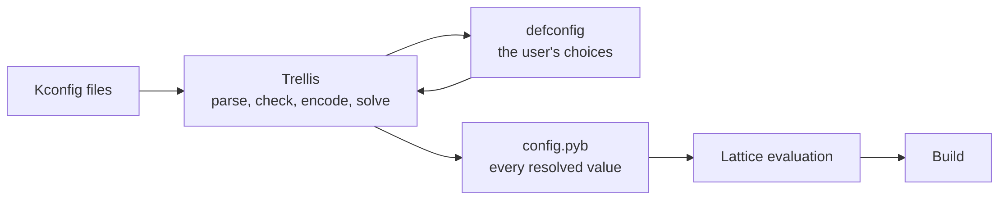

# RFC 0003 · Configuration System

Draft
RFC <strong>0003</strong>
Scope <strong>Trellis</strong>

| Field | Value |
| --- | --- |
| Status | Draft, open for comment |
| Supersedes | None |
| Components | Trellis: option language, encoding, solver, resolution, explanations, files, console |

The key words MUST, MUST NOT, SHOULD, SHOULD NOT and MAY in this document are to be interpreted as described in [RFC 2119](https://www.rfc-editor.org/rfc/rfc2119) and [RFC 8174](https://www.rfc-editor.org/rfc/rfc8174) when, and only when, they appear in all capitals.

## 1. Summary

Trellis lets a user choose the features of a system, such as which packages, which stack in each slot and which services, from a tree of options written in a subset of the Linux Kconfig language. The user's choices are kept in a defconfig. A SAT solver resolves them, with the rules of the tree, into one value for every option and writes the result as `config.pyb`, a generated PyBonsai file of values for the system description to use. Choices that cannot all hold are reported as the smallest set of choices and rules in conflict, together with the smallest sets of choices whose removal would allow what the user asked for.

Trellis is a separate package and submodule, `src/trellis`, with the command `trellis`. Lattice runs it as `lattice config`. It does not touch the store and depends only on Pydantic, so other projects with a Kconfig-style option tree can use it on its own.

## 2. Motivation

A PyrixOS system has options that depend on one another: a driver needs a subsystem, a stack in a slot excludes another, a service needs a package. Written as plain values in a PyBonsai file, such dependencies are checked only when a build fails, or not at all. The Linux kernel solved the same problem with Kconfig, a small language of options with `depends on`, `select` and defaults, and with `menuconfig`, which kernel developers and distribution maintainers already know.

The kernel's own tools resolve options in one pass and resolve a contradiction by turning an option off without saying why. ConfigFix showed that encoding Kconfig as a SAT problem lets a tool explain a conflict and propose fixes. Trellis takes the language and that approach, and adds the property PyrixOS needs everywhere else: the same inputs always give the same result.

## 3. Goals and non-goals

| Goals | Non-goals |
| --- | --- |
| A language kernel developers already know, kept to a subset that cannot reach outside the option tree | The full Kconfig language, including macros that run programs |
| The same tree and choices give the same configuration on every machine, with every solver backend | Configuring the Linux kernel's own `.config` (section 11) |
| A conflict is reported with its cause and the ways to remove it, never resolved silently | Choosing between fixes for the user |
| Solving happens before evaluation, so PyBonsai stays hermetic and simple | Calling the solver from a PyBonsai file |
| A library first, with the command and the consoles calling only the library | |

## 4. Where it sits

| Rule | Reason |
| --- | --- |
| Solving happens in Trellis, never during evaluation | Evaluation stays hermetic (RFC 0001 section 7). `config.pyb` is a plain generated file of values. |
| The defconfig holds only what the user chose | It is kept under version control. `config.pyb` is generated from it, and `trellis check` confirms in CI that it is current. |
| Nothing outside the option tree is read | Macros, `option env` and `source` of paths outside the tree are refused, for the reason PyBonsai refuses imports. |

## 5. Language

### 5.1 Accepted constructs

Entries: `config`, `menuconfig`, `choice` and `endchoice`, `menu` and `endmenu`, `if` and `endif`, `comment`, `mainmenu` and `source`.

Attributes: the types `bool`, `tristate`, `int`, `hex` and `string`, `def_bool`, `def_tristate`, `prompt`, `default`, `depends on`, `select`, `imply`, `range`, `visible if`, `optional`, `modules` and `help`.

Expressions: symbols, the constants `y`, `m` and `n`, `!`, `&&`, `||`, parentheses, and `=` and `!=` between bool and tristate symbols or constants.

### 5.2 Refused constructs

A file that uses any of these MUST be refused with its file and line. Nothing is skipped.

| Construct | Reason |
| --- | --- |
| Macros and `$(...)` functions | They run programs and read the environment |
| `option env`, `option defconfig_list` | They read outside the tree |
| `rsource`, `osource`, a `source` path that leaves the directory of the top file, including through a symbolic link | They read outside the tree, or depend on files that may be missing |
| Tristate choices | Rarely used; a bool choice covers the PyrixOS cases |
| `<`, `>`, `<=`, `>=` | Numeric comparisons of `int` and `hex` options would bring arithmetic into the clauses |
| Expressions in defaults and ranges of `int`, `hex` and `string` options | Their values are literals, so they need no solver |

### 5.3 Checks

The tree MUST also be refused when a symbol is used but never defined, a symbol is defined twice, `depends on` and `select` form a cycle, more than one option carries `modules` or that option is not bool, a choice default is not a member of the choice, a choice member is selected, or a comparison takes anything but bool and tristate operands. A choice without a name is named `<choice FILE:LINE>`.

The parser MUST refuse `source` files, blocks, `menuconfig` levels and expressions nested more than 100 deep, and the checker MUST refuse an option whose conditions, gathered from its enclosing blocks, nest more than 200 deep. Long flat trees and long chains of `depends on` are not limited.

## 6. Encoding

Each bool option is one variable. Each tristate option is a pair of variables, at least `m` and exactly `y`, with `y` implying `m`, and `m` without `y` allowed only when the `modules` option is `y`. An expression is converted to clauses with the Tseitin transformation.

| Kconfig | Meaning in the clauses |
| --- | --- |
| `depends on E` | The option is at most `E` |
| `prompt "..." if E` | Visible only while `E` and the dependencies hold; when not visible, the option takes its default or `n` |
| `select Y` | `Y` is at least the value of the selecting option, and the dependencies of `Y` MUST hold. Linux lets `select` ignore them; Trellis reports a conflict instead. |
| `default V if E` | While the prompt is visible, a preference; while it is not, the value |
| `imply Y` | A preference that `Y` is at least the value of the implying option |
| `choice` | Exactly one visible member is `y` when the choice is enabled; with `optional`, at most one |
| `range` | Checked after solving, since `int` and `hex` options are not in the clauses |

An upper bound of `m` counts as `y` for a bool option, and for a tristate option while modules are off, as in Linux. So `default m` without modules gives `y`, and a bool option that depends on a tristate option set to `m` can still be `y`.

Every rule has its own selector variable, so the solver can say which rules a conflict needs. The clauses MAY be exported in DIMACS form with `trellis export-dimacs` for any other solver.

## 7. Resolution

The user's choices are assumptions. Resolution then runs three steps:

1. The preferences, that is defaults while visible, `imply` and the default member of a choice, are tried in the order of the tree. Each is kept if everything kept so far can still hold. The default of an option the user set is skipped, since the option takes the user's value, so setting `A=n` does not turn off what `A` depends on.
2. Every bool and tristate option, in the order of the tree, is made as small as it can be.
3. Each `int`, `hex` and `string` option whose dependencies hold takes the user's value, or else its first default whose condition holds, and MUST lie in its first range whose condition holds.

Each step fixes something no later step can undo. The result therefore does not depend on which model a solver returns along the way, and every backend MUST give the same configuration. An optional choice starts with no member chosen.

Trying a run of preferences together first, and halving the run when it cannot hold, keeps exactly the preferences that trying them one by one would keep, with far fewer solver calls. The built-in solver also keeps its work on the assumptions that a call shares with the start of the previous one, and finds a core only when asked for one. A tree of 3,000 options resolves in about a third of a second on the development machine.

Because preferences come after the user's choices, a choice can move a preferred option. If the user sets an option that is only promptable while another option is off, Trellis turns that other option off rather than reporting a conflict, since only a preference stood in the way.

## 8. Explanations

| Question | Method | Answer |
| --- | --- | --- |
| Why does `X` have its value? | The choices, rules and preferences that force it, with the current values of the symbols they name | `you set X=y`, `Y=m selects it (Kconfig:12)`, `it cannot be n: ...` |
| Why can `X` not be `v`? | The solver's core under the choices, the rules and `X=v`, shrunk by deletion until removing any part makes the rest hold | The smallest set of choices and rules in conflict, each rule with its file and line |
| What would allow `X=v`? | Minimal correction sets, as ConfigFix proposes for Linux: the choices are kept one by one while `X=v` can still hold, and those left out form one set; a clause requiring at least one of them to be kept leads to the next | Up to a limit of sets, each with the values that would change |

When the rules alone forbid `X=v`, there is no fix and Trellis says so.

## 9. Files

The defconfig uses the Linux format. Each line is `CONFIG_NAME=VALUE`; `# CONFIG_NAME is not set` means `n`; strings are quoted with backslash escapes; when a name appears twice, the later line wins. It lists the user's choices in the order of the tree. A choice of an option the tree no longer has, or one without a prompt, is reported and ignored rather than refused, so an old defconfig still loads. `trellis savedefconfig` writes the smallest defconfig that gives the same configuration.

`config.pyb` starts with a comment saying it is generated, then binds `options` to a dict of every option in the order of the tree. Bool options are `True` or `False`, tristate options `"y"`, `"m"` or `"n"`, `int` options numbers, `hex` options hexadecimal numbers and `string` options strings. It has no license header because it is generated.

Both files MUST be written atomically, by writing a temporary file in the same directory and renaming it over the old one, and keep the mode of the file they replace. Nothing is written when the choices conflict.

## 10. Interfaces

The `Configurator` class is the interface: `load`, `set`, `unset`, `restore`, `resolve`, `explain`, `conflict`, `fixes`, `minimal`, `set_all`, `save` and `dimacs`. Its results are Pydantic models. The command and both consoles call only its methods.

| Command | Does |
| --- | --- |
| `trellis menu` | Full-screen menu with `curses`: Enter opens or edits, Space cycles, `y`, `m` and `n` set, `?` shows help and why, `a` shows hidden options, `1` to `3` apply a fix, `s` saves, `q` quits |
| `trellis old` | Asks one line at a time about options the previous `config.pyb` lacks; works without `curses` |
| `olddefconfig`, `defconfig`, `savedefconfig`, `set`, `allyes`, `allno`, `check`, `explain`, `export-dimacs` | Non-interactive, with Linux's names where the meaning is the same |

The exit status is 0 on success, 1 when the choices conflict or a check fails, and 2 for an error in a file or an argument. `lattice config ARGUMENTS` runs `trellis ARGUMENTS` and always runs locally.

The built-in solver is a CDCL solver in pure Python with watched literals, first-UIP learning, a deterministic activity order, restarts, assumptions and cores. It is the reference. PicoSAT MAY be used instead when its library can be loaded. Every command reports the time the solver took.

## 11. Security considerations

A Kconfig tree is input that decides what is built, and it may come from a third party. The subset is chosen so that reading it cannot run a program, read the environment or open a file outside the directory of the top file. `source` paths are resolved and refused if they leave that directory, including through a symbolic link, or contain a NUL byte. The nesting limits of section 5.3 keep a hostile tree from exhausting the interpreter's stack. The parser is written for Trellis rather than taken from a full Kconfig implementation, since a full implementation would also have to refuse what it was written to run.

`config.pyb` is evaluated by PyBonsai, so even a file edited by hand cannot do more than any other PyBonsai file. Strings are written with JSON escapes, which PyBonsai reads as the same string.

## 12. Alternatives considered

kconfiglib
:   A complete Kconfig implementation under the ISC license. It implements `$(shell,...)`, which Trellis must refuse, and it would be the only parser of a language that decides what is built. Trellis has its own parser of the subset.

Selecting options whose dependencies fail
:   Linux allows it and prints a warning, for compatibility with old trees. PyrixOS has no such trees, so it is a conflict.

Solving during evaluation
:   A `solve()` builtin in PyBonsai would make evaluation depend on a solver and its run time. Solving first keeps evaluation simple, and the result is a file anyone can read.

A subpackage of Lattice
:   Trellis does not use the store, and other projects can use it, so it is a separate package.

## 13. Resolved and deferred questions

Reading config.pyb
:   Resolved by RFC 0004. Lattice evaluates the `config.pyb` next to a system description as a PyBonsai file of its own and gives its `options` to the description as the read-only mapping `config`. The file is an input of the system, so a change of option changes the hash of every derivation that reads it.

Linux kernel configuration
:   In PyrixOS 1.0, Trellis does not edit a kernel `.config`. The kernel package starts from the kernel's own `defconfig` and applies fragments written in PyBonsai, inside the sandboxed build, with the kernel's own `kconfig` tools. A Trellis option may choose which fragments apply.

Tristate choices
:   Not needed, since kernel options are not expressed with Trellis in 1.0. They stay refused.

Menu search and history
:   Deferred past 1.0. The `/` key for search and a list of changes since the last save are planned for a 1.x release; neither changes a file format.
